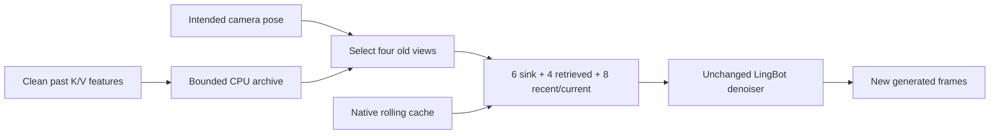

# How the strongest results work

The strongest controlled result is **historical-view KV retrieval**: keep a small archive of what the model previously saw, then let it attend to relevant old views when returning. It improves several scripted returns without training or editing output frames. **It has not established an improvement on the full PlayWorld benchmark or beaten Genie 3.**

For the larger-cache and bounded-memory variants, see the [detailed method notes](docs/METHOD.md).

## Results and their limits

These are separate experiments, not one ranking. Gemini uses the released scorer through Vertex with `gemini-3.1-pro-preview`; equivalence to the paper’s model alias is not established.

| Experiment | Stock | Method | Interpretation |
|---|---:|---:|---|
| Three scripted tasks, seed 42, Gemini | 1.00 | **3.53**, four-view memory | Strong local subset result; not adaptive play or an overall score |
| Adaptive GC027, seeds 42/43, Gemini | 3.10 | **1.50**, four-view memory | No successful visual return; this method does not generalize here |
| 14 GC/out-of-sight cases × two seeds, Gemini | 1.81 | **2.26**, 46-frame cache | Two-dimension subset only; paired +0.46, case-cluster 95% CI −0.35 to +1.21, so an overall improvement is not established |

Sources: [scripted task judgments](reproduction/gemini-current/episodes/), [adaptive comparison](reproduction/adaptive-four-view/README.md), and [larger paired study](reproduction/powered-comparison/pooled/README.md). The scripted cohort contains GC010, GC033 and GC040; GC013 is excluded for a released image/caption mismatch. Historical Claude scores are retained separately in the [leaderboard](LEADERBOARD.md).

The clearest long-horizon example is a **31.8-second mall episode with 24 seconds away from the starting view**. Stock substitutes different buildings on return; memory recovers the original facade. Endpoint DINO similarity rises 0.574→0.746, and a blinded complete-video review prefers memory. See [the write-up and videos](reproduction/memory-validation/README.md).

## Retaining full history with a compressed cache

A matched14B GC010 control isolates capacity: native58 slots retain the entire56-latent trajectory and recover recognizable original street buildings where stock18 substitutes new ones. Both match raw pixels through chunk3. Gemini gives stock18 1.0 and native58 5.0; this is one scripted development case, not an overall result.

An isolated integration of the released NanoKV codec reproduces all14native58 chunks exactly in identity mode before lossy compression is enabled. Compressed58 keeps recognizable landmark recovery at57.33GB peak allocated GPU memory instead of121.39GB. Its payload plus operators occupy3.44GB versus69.18GB of occupied raw history. It also introduces fidelity loss: Gemini scores it2.8 versus native58's5.0. One cold run takes223s versus205s, so this is a memory saving with a latency/quality tradeoff. [Full evidence and longer-history test plan](reproduction/nanokv/README.md). No generator training is required; the codec is a released fitted artifact, not a new model we trained.

## What changes inside the model

LingBot generates short chunks and keeps a rolling key/value cache. Once older views leave that cache, it can generate a plausible new building instead of the building seen earlier. The method preserves selected old internal features beyond the rolling window.

1. **Archive clean features.** During the clean cache-update pass, save each layer’s canonical keys before rotary position encoding, plus its values. The frozen version archives 16 early, non-sink latent frames, indices 6–21, in BF16 on CPU. It uses about 19.77 GB; this is additional memory, not free context.
2. **Select old views by pose.** At each chunk, rank archived views by distance and heading relative to the intended camera pose. Require distance ≤8 normalized units and heading difference ≤60°. Exclude sink frames and recent frames. Use the four nearest eligible views. These are commanded poses, not measured physical camera poses or meters.
3. **Make retrieved keys temporally usable.** Apply rotary position encoding again at four virtual positions just before the recent context. Values remain unchanged. This presents old visual evidence at positions the model can use near its current window.
4. **Preserve recent motion context.** Construct the attention input as **6 sink + 4 retrieved + 8 recent/current latent frames**. The total stays at 18. The native persistent cache is not overwritten with retrieved slots; the attention read uses a temporary composition.
5. **Generate normally.** Keep the pretrained weights, four-step sampler, camera conditioning and native VAE decoder. Release temporary GPU retrieval buffers before decoding. Every output frame is newly generated; stored images are not pasted into the video.



Implementation: [selection and attention composition](worldsync/lingbot_retrieval.py), [rollout integration](worldsync/lingbot_rollout.py), and [camera mapping](worldsync/lingbot_controls.py). This is a small training-free adaptation inspired by memory/retrieval research, not a claimed reproduction of another paper.

## Why the evidence is more than a good final image

We check native camera-input parity, preserve failures, compare complete videos, and compare raw generated-pixel hashes before retrieval. In the adaptive experiment, **both pairs match stock exactly for the first 12 chunks**; retrieval activates on chunk 12, exactly where the first pixel difference appears. That isolates the intervention—but neither run returns to the original scene, so it is a negative result.

Endpoint similarity alone can mislead. On the held-out fountain example, memory restores the original fountain and nearby landmarks but overshoots toward a bench. Its final-frame DINO score falls **0.885→0.083**, despite the full-video reviewer preferring its recovered scene. Both the poor endpoint score and the framing failure remain in the report.

## What still breaks

- **Archive coverage and late activation.** The initial neutral view lies in frames 0–3, outside this archive. On adaptive GC027, retrieval occurs only in the final chunk. Start-view re-anchoring was tested separately and still did not restore the original view.
- **Exact geometry and heading.** Recognizable landmarks can return with changed proportions, viewpoint, textures or lettering.
- **Third-person control.**47/50IF tasks require third-person behavior, while this checkpoint exposes camera control without an explicit trained avatar-action input. Some failures precede any memory issue. [Audit](docs/control-scope.md).
- **Dynamic state.** Old features are not a simulator of what happened while an object was hidden. Moving people, mixing liquids and other processes can freeze, reset or become inconsistent.
- **Recent context matters.** Eight retrieved views inside the same 18-frame budget displace useful recent frames and degrade continuity. Expanding to 22 frames avoids that particular problem but did not improve the three-task confirmation. Fixed separate-history attention weights also failed.
- **Small-sample and judge uncertainty.** The same beach video scored 2.70 and 3.75 in separate Claude calls. Gemini and Claude can rank the same methods differently. Subset means are not comparable with the published 1.82 or 2.12 overall scores.

Negative ablations: [more retrieved views](reproduction/multiview-retrieval/), [protected recent context](reproduction/task-context-validation/), [separate attention gates](reproduction/separate-history-attention/), and [start-view re-anchoring](reproduction/start-anchor-replay/README.md).

## Reproduce and review

Start with the [frozen validation plan](reproduction/memory-validation-plan.json) and [task pilot plan](reproduction/task-memory-benchmark-plan.json). Each completed case includes its manifest, full video, hashes and judgment. Model and source revisions are pinned; camera commands and intended trajectories are recorded. No training was used for the selected four-view method.

The [leaderboard](LEADERBOARD.md) is the current results index. Regenerate its tables from committed summaries with:

```bash
.venv-lingbot/bin/python scripts/update_leaderboard.py
```

Runtime improvements are separate from quality claims: [persistent workers](reproduction/modal-runner.md), [streamed player overlap](reproduction/player-streaming/README.md), and [lossless disk-backed memory on the local GPU](reproduction/lingbot-local-memory/README.md). They make experiments feasible; they do not by themselves raise the benchmark score.

An experimental [learned memory reader](docs/differentiable-memory.md) now has a completed 14B gradient/checkpoint plumbing test. Its separate branch has about 0.66M trainable parameters; the base model stays frozen. The synthetic probe is not a quality improvement and cannot be a benchmark candidate. A real-data fit has completed, but only one of two held-out sources beats the no-memory denoising control. It is not promoted; player-driven quality validation remains pending.

The [endpoint audit](reproduction/task-memory-benchmark/return-audit.jpg) shows all three declared scripted task pairs, including the weakGC033 result. All three memory videos have judge-reported returns, and recognizable landmarks reappear in their sampled endpoints. Endpoint images cannot establish continuity through the whole path. This is stronger evidence than the small-model partial-trajectory score, but remains separate from adaptive and full-benchmark validation.
