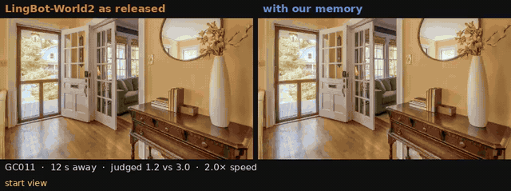
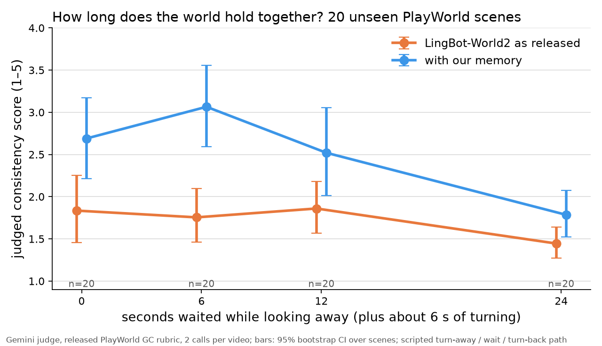

# RECALL

**When the camera looks back, a world model recalls what it already generated, instead of inventing it again.**

*RECALL = Retrieval of Earlier Camera views for Long-horizon Lookback.* A training-free episodic memory for
[LingBot-World2](https://github.com/Robbyant/lingbot-world-v2) (14B, open weights). Built for Track 4 (World Models):
*how long can a generated world hold together while an agent plays in it?*

[Slides](docs/slides/index.html) · [2-minute video](docs/demo/presentation.mp4) · [Demo page](docs/DEMO.md) ·
[Side-by-side gallery](docs/GALLERY.md) · [Leaderboard](LEADERBOARD.md) · [Method](docs/METHOD.md) ·
[Plain-language explainer](docs/EXPLAINER.md) · [Development log](docs/PROGRESS.md)



*Same scene, same seed: the camera turns away for 12 s and turns back. Left: the model as released invents a different
room. Right: with RECALL the room comes back. Selected example (GC011); losses exist and are in the
[appendix](docs/demo/APPENDIX.md).*

## TL;DR

- **The problem.** LingBot-World2 looks back at only about 4.5 s of its own video (a cache of 18 latent frames). Look away for
  longer and the place you left is replaced by an invented one: a different building, a re-lettered sign, a missing object.
- **What we did.** Keep the model's earlier frames in an archive tagged with the camera pose. When the camera comes back,
  hand the nearest ones back to the model's attention. No training, no weights changed.
- **What we measured.** On a pre-registered test of 20 unseen [PlayWorld](https://github.com/kxding/PlayWorld) scenes
  (turn away, wait, turn back), judged consistency improves at every waiting time, **+0.77 [+0.51, +1.04] pooled** over
  6, 12 and 24 s away (1-5 scale, PlayWorld's own Gemini judge).
- **What we did not achieve.** On PlayWorld's own 171 short tasks the memory made no difference (1.80 vs 1.85 for stock).
  We reproduced the open baseline (1.81 and 1.85 vs the published 1.82). **Genie 3's 2.12 is not beaten**, and we do not claim it.

## How it works



1. **Archive.** After each generated chunk, save its frames' cached keys and values (all 40 layers) together with the camera pose
   (position and heading) at that moment. The archive holds up to 24 latent frames, about 6 s.
2. **Retrieve.** Before each chunk, compute the pose the camera is about to have from the movement commands and pick the 10
   archived frames with the nearest pose. This is a lookup on numbers; it never compares pictures.
3. **Splice.** The model's attention window becomes first 6 + retrieved 10 + most recent 8 frames (24 in total, against stock's
   18). Everything else is unchanged.

**A separate storage finding.** Instead of caching a frame's 40-layer keys and values (1,235 MB), store the frame and recompute them
when needed (6.2 MB, about **200x less**). On a scripted turn-away path it recovered the start view as well as exact storage
(similarity 0.77 vs 0.78; stock 0.35). This was tested on scripted paths only, not in the benchmarks below.
See the [explainer](docs/EXPLAINER.md#where-200x-less-storage-comes-from).

## Results

Revisit-horizon benchmark ([write-up](reproduction/revisit-horizon.md)): 20 held-out PlayWorld GC scenes, scripted 180-degree
look-away and return, one seed, 2 Gemini calls per video, paired differences with 95% bootstrap intervals over scenes.
These are our scripted paths, **not PlayWorld's tasks, and not comparable with the published 1.82 or 2.12.**

| Time away | Stock | RECALL | Paired difference [95% CI] | Scenes better / tied / worse |
|---|---:|---:|---|---|
| 0 s | 1.84 | 2.69 | +0.85 [+0.28, +1.47] | 13 / 1 / 6 |
| 6 s | 1.76 | 3.06 | +1.31 [+0.74, +1.90] | 17 / 1 / 2 |
| 12 s | 1.86 | 2.52 | +0.66 [+0.18, +1.13] | 14 / 2 / 4 |
| 24 s | 1.44 | 1.79 | +0.34 [+0.05, +0.64] | 12 / 3 / 5 |

The gain shrinks as the wait grows because the archive is small. A DINO similarity between the final and first frame
moves by only +0.02 to +0.08 (intervals touch zero), so the judged gain is mostly object identity and texture (an exploratory breakdown), not an exact match.

PlayWorld's full 171-task benchmark ([table](reproduction/full-run/table.md), frozen configuration, one seed):
stock **1.85** [1.67, 2.04], memory **1.80** [1.63, 1.98], paired difference -0.04 [-0.26, +0.16].
The pass criterion for beating 2.12 was [pre-registered](reproduction/pass-criterion.md) and **not met**.
Why memory did not help there: [audit](reproduction/full-run-memory-audit.md). Most tasks are shorter than the model's own memory,
and only about 12% of chunks are real revisits.

## What we tried that did not work

- **Text director** (a language model writes event captions for the world model): +0.02 [-0.15, +0.19] on 171 tasks, not established ([run](reproduction/final-run/table.md)).
- **Verified retrieval** (retrieve only on a confirmed return, archive everything): removes unneeded retrievals, but scored
  -0.35 [-0.71, -0.01] against stock on 36 real PlayWorld revisit tasks ([write-up](reproduction/memory-v2.md)).
- **Memory fine-tuning** (small LoRA on real revisit pairs): no gain over plain retrieval and it degraded ordinary generation ([lora](reproduction/lora/README.md)).
- **Compressing the cache itself** (fewer layers, pooling, low-rank): the memory stopped working on a second scene ([ablation](reproduction/memory-storage-ablation.md)).

## Autoresearch loop

The research ran as a loop: AI agents proposed a method, ran experiments on cloud GPUs, a separate set of AI agents audited the code
and the results, then diagnosed, fixed and re-tested. Humans set the goals and the budget and made key calls. Every run froze its
configuration and pass criterion first; findings are stored in [past.dev](https://past.dev) as dated, sourced text
([details](reproduction/research-memory/README.md)). Failures are kept and reported. Everything is in [`reproduction/`](reproduction/README.md).

## Quickstart

Requirements: one 80 GB GPU (our runs used H100 PCIe/SXM with `--offload-text-encoder`; stock-sized episodes need about 72 GB, and the
memory adds a few GB, peak about 93 GB on a larger card), the
[LingBot-World2 14B causal-fast weights](https://huggingface.co/robbyant/lingbot-world-v2-14b-causal-fast), the PlayWorld data, and a `gcloud` login or Gemini key for judging.
Cloud setup we used is recorded in [`reproduction/lambda-log.md`](reproduction/lambda-log.md) and `scripts/lambda_setup.sh`.

```bash
pip install -e ".[test,benchmark]"
pytest                                   # unit tests (need torch installed; no GPU for most)

# Generate one revisit episode: turn right, wait 12 s, turn back (stock; add the three memory flags for RECALL)
python -m worldsync.lingbot_rollout --split gc --task-id GC042 --seed 42 --max-chunks 20 \
  --native-fixed-controls --turn-degrees-per-second 68 --offload-text-encoder \
  --fixed-actions WAIT RIGHT RIGHT RIGHT WAIT WAIT WAIT WAIT WAIT WAIT WAIT WAIT WAIT WAIT WAIT WAIT LEFT LEFT LEFT WAIT \
  --output outputs/example-stock
#   RECALL: append  --budget-memory --budget-rope native --budget-retrieved 10 --budget-store exact

# Judge videos with PlayWorld's released prompts on Vertex AI (needs a manifest; see reproduction/revisit-horizon.md)
python -m worldsync.gemini_vertex_judge --manifest MANIFEST.json --output-dir outputs/judged

python scripts/revisit_horizon.py analyze   # revisit-horizon tables and figure
python scripts/update_leaderboard.py        # regenerate LEADERBOARD.md from the stored results
```

The exact job lists, flags and seeds for every reported number are committed (for example
[`reproduction/revisit-horizon-jobs.jsonl`](reproduction/revisit-horizon-jobs.jsonl)).

## Repository map

- `worldsync/`: the code (Python package name kept from the project's first name): rollout, pose memory, storage, judge clients.
- `reproduction/`: one write-up per experiment, frozen configs, job lists, per-episode scores, audits and logs.
- `scripts/`: runners, analysis, cloud tooling, leaderboard and figure generators.
- `docs/`: [demo page](docs/DEMO.md), [explainer](docs/EXPLAINER.md), [method](docs/METHOD.md), [slides](docs/slides/index.html), clips.
- `LEADERBOARD.md` and `leaderboard.json`: every comparable number, generated by a script.

## Caveats

- **The judge is noisy.** The same video scored three times varies by about 0.36, and identical videos have received 1.0 and 5.0.
  We average calls and pair arms by scene; the revisit-horizon intervals are over 20 scenes and one seed.
- **Local checkpoint, our player.** Numbers come from the public checkpoint, our own agent player and the preview Gemini model, not the hosted
  service behind the published 1.82. Cloud GPUs differ slightly in output.
- **The window is bigger.** Our attention window has 24 frames against stock's 18. A plain 24-frame window reaches back only about 6 s,
  so the gains at 12 and 24 s come from retrieval, but part of the 0 and 6 s gains may come from the larger window.

## Acknowledgements and citation

Built on [LingBot-World2](https://github.com/Robbyant/lingbot-world-v2) (itself based on Wan2.2) and evaluated with
[PlayWorld](https://github.com/kxding/PlayWorld). Thanks to the benchmark authors for releasing prompts, rubrics and the judge.

```bibtex
@misc{recall2026,
  title  = {RECALL: Retrieval of Earlier Camera views for Long-horizon Lookback in an open world model},
  author = {{RECALL contributors}},
  year   = {2026},
  note   = {Code and logs: https://github.com/npow/recall}
}
```
