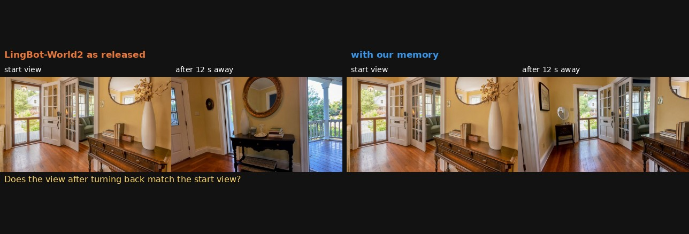
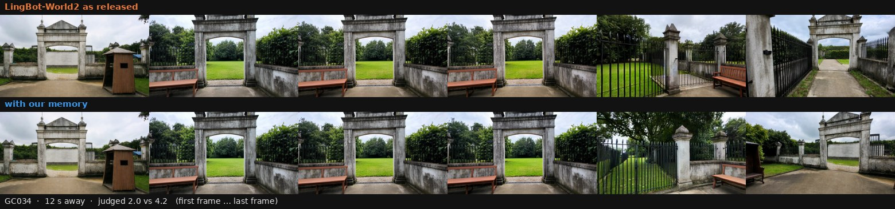
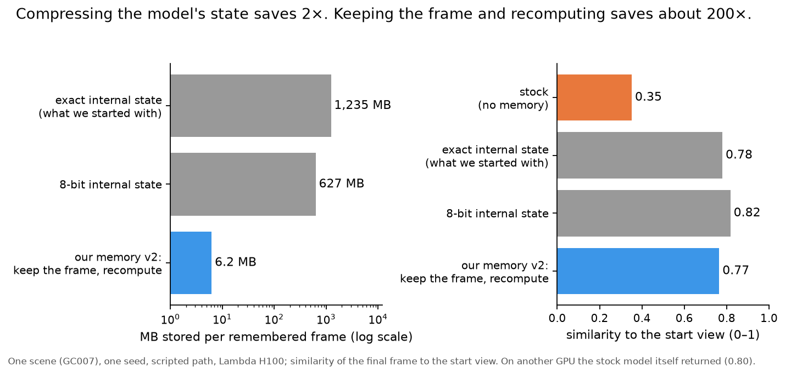
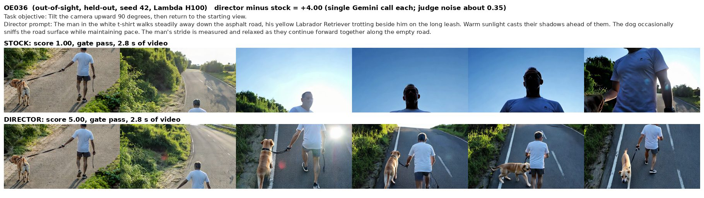
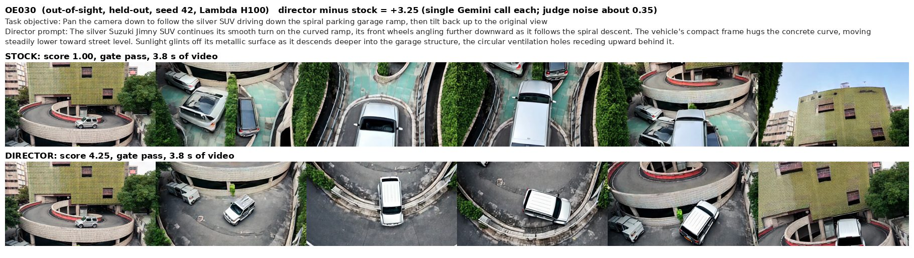
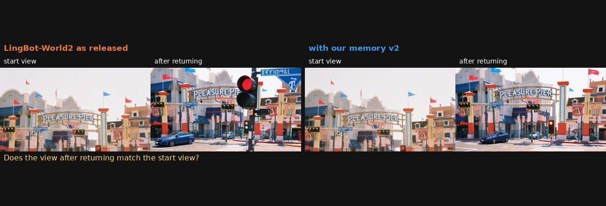
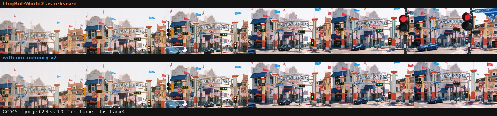
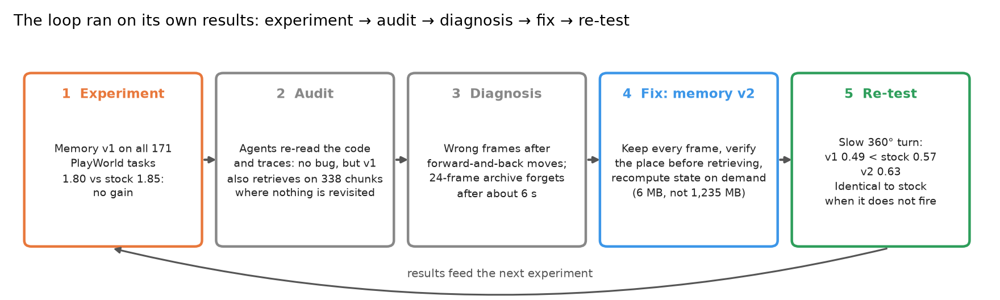

# WorldSync demo: making a generated world remember where it has been

**Track 4 question: how long can a generated world hold together while an agent plays in it?**

We took an open world model (LingBot-World2, 14B) and added a **training-free episodic memory**: when the camera comes back to
a place it has already seen, the model is handed its own earlier frames of that place. It stores only the frame and recomputes
the model's internal state on demand, which takes **about 200× less memory** than storing that state.



**Hero video (20 s): [demo/hero.mp4](demo/hero.mp4)** · selected example, PlayWorld scene GC011: the camera looks away for
12 s and turns back. Left: LingBot-World2 as released. Right: with our memory. Alternates: [GC034](demo/hero-GC034.mp4), [GC026](demo/hero-GC026.mp4).

| | Headline result | Status |
|---|---|---|
| 1 | **After 12 s looking away, on 20 unseen PlayWorld scenes: judged consistency 1.86 → 2.52, paired +0.66 [+0.19, +1.12], 14 wins / 2 ties / 4 losses**; 6 s: 1.76 → 3.07 (+1.31 [+0.74, +1.89]); 24 s: 1.45 → 1.78 (+0.34 [+0.05, +0.64]); pooled +0.77 [+0.51, +1.03] | pre-registered |
| 2 | **6.2 MB per remembered frame instead of 1,235 MB (about 200×) at about the same recall** (0.77 against 0.78; stock 0.35) | one scene, one seed, one GPU type |
| 3 | **Published baseline reproduced twice with the open checkpoint: 1.85 and 1.81 overall against the published 1.82** | all 171 PlayWorld tasks |
| 4 | **Best subset of PlayWorld's own tasks: out-of-sight evolution with our text director, 1.32 → 1.53, a trend of +0.20 [−0.12, +0.58]** | post-hoc choice of subset and metric |

One honest line: on the full PlayWorld benchmark our methods score 1.80 to 1.86 overall, level with LingBot's published 1.82
and below Genie 3's 2.12, and no subset of PlayWorld's own tasks shows a gain whose interval excludes zero. The clear gain is on
long absences, which PlayWorld's own tasks rarely contain.

---

## Results

### How long does the world hold together?


Twenty PlayWorld geometry-consistency scenes that we never used in development, chosen by a hash of the scene id. The camera
turns away 180°, waits, and turns back. Same seed and same GPU for both arms. The Gemini judge scores each video twice with
PlayWorld's released consistency rubric. These are PlayWorld scenes with our own scripted path, not PlayWorld's task list.

| seconds away | scenes | as released | with our memory | paired difference [95% CI] | wins/ties/losses |
|---:|---:|---:|---:|---|---|
| 0 s | 20 | 1.84 | 2.69 | +0.85 [+0.29, +1.45] | 13/1/6 |
| 6 s | 20 | 1.76 | 3.07 | +1.31 [+0.74, +1.89] | 17/1/2 |
| 12 s | 20 | 1.86 | 2.52 | +0.66 [+0.19, +1.12] | 14/2/4 |
| 24 s | 20 | 1.45 | 1.78 | +0.34 [+0.05, +0.64] | 12/3/5 |

Pooled over the 6 s, 12 s and 24 s absences, scenes as units: +0.77 [+0.51, +1.03] (n = 20). The turn
away and back adds about 6 s to each absence, so even the 0 s row is beyond the model's 4.5 s window. Source: `docs/demo/horizon-summary.json`
(160 of 160 episodes scored).

### Selected examples

Each clip shows the whole episode, sped up to about 10 s. The full rule-based set, including losses, is in [demo/APPENDIX.md](demo/APPENDIX.md).

**GC011, 12 s away: judged 1.2 → 3.0.** Stock comes back to a different wall and a porch railing; with memory the front door, sidelights and console table of the start view are back. [video](demo/horizon-win-GC011-H12.mp4)


**GC034, 12 s away: judged 2.0 → 4.2.** Stock comes back to a close-up through a fence with a different layout; with memory the stone gate and the wooden hut beside it are back. [video](demo/horizon-win-GC034-H12.mp4)



**GC026, 12 s away: judged 2.4 → 4.6.** Stock comes back to a close-up of a different shop door; with memory the red Diamond Design awning and arched entrance are back, seen from further away. [video](demo/horizon-win-GC026-H12.mp4)


### About 200× less memory



To reuse an old frame, the model needs that frame's internal state at all 40 of its layers: 1,235 MB per frame. Compressing
that state gets to 2× at best (8-bit floating point; nineteen formats tested, `reproduction/memory-storage-ablation.md`).
Memory v2 keeps only the frame, 6.2 MB with its conditioning, and recomputes the state when the camera returns: 13.5 s of extra
compute in a 14-chunk episode, GPU memory 72.4 GB against 68.8 GB for the stock model. The recall figures are from one scene
and one seed on a scripted path, on cloud H100s; on a different GPU the stock model itself returned on this path (0.80), so
read them as "recompute matches stored state", not as the size of the memory effect.
[Side-by-side video, GC007](demo/memv2-hold-GC007.mp4): stock ends at a storefront close-up; memory v2 ends on the facade and plaza seen at the start.


### On PlayWorld's own tasks

| 171 tasks, Gemini judge | overall [95% CI] |
|---|---|
| LingBot-World2, published (hosted service) | 1.82 |
| LingBot-World2 open checkpoint, our run 1 | 1.85 [1.67, 2.04] |
| LingBot-World2 open checkpoint, our run 2 | 1.81 [1.64, 1.99] |
| + our text director (run 2 hardware) | 1.82 [1.66, 2.01]; mean of 3 judge calls: 1.86 [1.70, 2.02] |
| Genie 3, published | 2.12 |

The text director writes the world model's prompt in the event-caption format it was trained on. Across all tasks it is a small
tendency (+0.07 [−0.06, +0.22] with three judge calls). Its best dimension, chosen after seeing the results, is out-of-sight
evolution on held-out tasks: 1.32 → 1.53, +0.20 [−0.12, +0.58], 9 wins / 19 ties / 9 losses. Selected examples (more, with
losses, in [GALLERY.md](GALLERY.md)):

**OE036: judged 1.0 → 5.0.** After the camera tilts up and returns, stock has replaced the man and dog; with the director they keep walking away. [video](gallery/outsight-OE036.mp4)



**OE030: judged 1.0 → 4.25.** Stock loses the ramp and the car; the director keeps the same car on the same ramp. [video](gallery/outsight-OE030.mp4)



**Memory v2 on PlayWorld's own revisit tasks** (pre-registered: the 36 geometry and out-of-sight tasks whose path revisits a view; three judge calls per video): not better than stock, and slightly worse. Paired judged difference -0.35 [-0.71, -0.02], 9/12/15 wins/ties/losses; held-out 31 tasks -0.26 [-0.65, +0.11]. Our judge-independent check, similarity of the return view to the start view, is flat (−0.02 [−0.08, +0.06]), and the player took different actions in the two arms on some tasks, so the judged loss cannot be pinned on the memory (`reproduction/memory-v2.md`, `reproduction/memory-v2-step2/per-case.csv`).

**Selected example from that set: GC045, "move 10 steps left, then 10 steps right to return"** (a development task). The player took the same 9 actions in both arms and the first 5 chunks are pixel-identical; memory fired once, at the turn-around. On the way back, stock pushes a large red traffic light and a changed street sign into the frame; with memory v2 the Pleasure Pier arch stays framed as it was. The judge does not separate the two videos (three calls: 2.4, 3.8, 5.0 for stock; 4.0, 5.0, 1.0 for memory v2), so this is a visible difference, not a scored one. [video](demo/playworld-GC045.mp4)





### Run the demo

One side-by-side on one 80 GB GPU (about 4 minutes per arm). `scripts/prepare_reproduction.py` fetches the PlayWorld inputs;
the LingBot checkpoint and environment are described in `reproduction/lingbot.md`.

```bash
ACTIONS="WAIT RIGHT RIGHT RIGHT $(printf 'WAIT %.0s' {1..12})LEFT LEFT LEFT WAIT"
COMMON="--split gc --task-id GC011 --seed 42 --max-chunks 20 --native-fixed-controls --fixed-actions $ACTIONS \
  --turn-degrees-per-second 68 --offload-text-encoder"
export PYTORCH_CUDA_ALLOC_CONF=expandable_segments:True
python -m worldsync.lingbot_rollout $COMMON --output outputs/demo/stock
python -m worldsync.lingbot_rollout $COMMON --budget-memory --budget-rope native --budget-retrieved 10 --output outputs/demo/memory
ffmpeg -i outputs/demo/stock/rollout.mp4 -i outputs/demo/memory/rollout.mp4 -filter_complex hstack outputs/demo/side-by-side.mp4
```

Add `--dry-run` to check the arguments without a GPU (verified on `main`). The benchmark videos above were generated with the
same flags at commit `edb2b83` on Lambda H100s; pixels differ between GPU models, so compare arms on one GPU.

---

## Research rigour

- **A clear question with a baseline first.** We reproduced the published LingBot-World2 score on all 171 PlayWorld tasks before
  claiming anything, twice, on different hardware: 1.85 and 1.81 against 1.82 (`reproduction/full-run/table.md`, `reproduction/final-run/table.md`).
- **Frozen before generation.** Every comparison has a config committed before its first video: `reproduction/full-run-config.json`,
  `reproduction/final-run-config.json`, `reproduction/revisit-horizon-config.json`, `reproduction/memory-v2-config.json`,
  and a success criterion written before any full score existed (`reproduction/pass-criterion.md`).
- **Paired designs with intervals.** Same task, same seed, same GPU model for both arms; bootstrap 95% intervals over tasks;
  development scenes excluded from held-out results; wins, ties and losses reported next to every mean.
- **Ablations with a clear conclusion.** Nineteen storage formats for the memory on two scenes
  (`reproduction/memory-storage-ablation.md`): only exact storage and 8-bit floating point (2× smaller) keep the revisit on
  both scenes; layer subsets, pooling, token subsets, integer 8-bit and low-rank each fail on at least one scene. So compressing
  the cached state buys at most 2×, and the 200× comes from recomputing. Retrieval rules v1, v2 and content-only side by side
  (`reproduction/memory-v2/step1/table.md`).
- **Independent audits.** A five-lens audit of baseline fidelity with a skeptic per claim (`reproduction/baseline-fidelity-audit.md`),
  a code-and-trace audit of the memory (`reproduction/full-run-memory-audit.md`), and a judge-repeat study that measured the
  judge's own noise at 0.36 points per video (`reproduction/judge-repeat/README.md`).

## Novelty

LingBot-World2 keeps a rolling cache of about 18 latent frames (6 anchor frames plus the most recent 12), roughly 4.5 s of
video. Anything older is gone, so a view the camera left is re-invented when it returns. Our memory adds four pieces, with no training:

1. **An episodic archive of every latent frame**, with its camera pose and a visual descriptor. Nothing is evicted.
2. **Pose-verified retrieval.** A stored frame is used only if its pose matches where the camera is going and the place is
   verified: either only rotation has happened since, or the current view matches a stored view of that place.
3. **Recompute and splice.** The keys and values of the retrieved frames are recomputed at all 40 layers with one clean pass,
   then spliced into the attention window in place of part of the recent history, keeping the same attention budget.
4. **Inert when not needed.** When no stored view qualifies, the output is bit-identical to the stock model.

How it differs from published work, as we read it (`reproduction/literature-review-2026-11-14.json`, `reproduction/vmem-lsm-robustdreamer.md`):

| | stores | chooses by | training |
|---|---|---|---|
| WorldKV | evicted keys and values | relevance of cached tokens | none |
| DeCoPrune | pruned keys and values | denoising discrepancy per token | none |
| VMem | past views, indexed by 3D surfels | what is visible from the new camera | fine-tuned generator |
| **ours (memory v2)** | **the frame only; state recomputed** | **pose, verified by content** | **none** |

What the tests of memory v2 establish (`reproduction/memory-v2/step1/table.md`): it is pixel-identical to the stock model
whenever it does not fire (v1 also retrieved on 338 of 726 chunks, 47%, where nothing was being revisited); recomputed state matches state
stored on disk (0.77 against 0.82 on the hold path, 0.62 against 0.63 on the slow turn); it needs no archive of internal state;
and it removes v1's harm on the slow 360° turn. These are single-scene, single-seed checks on one GPU type.

Storing the frame and recomputing the state is what gives the 200× saving; we did not find it in the papers we surveyed, and
we have not searched exhaustively. We also tested 8-bit, low-rank, pooled and layer-subset versions of the stored state;
only 8-bit floating point held up on both test scenes, at 2×.

## Autonomy and self-improvement



- **Most of the loop ran without a human.** Agent forks designed experiments, wrote the code, launched up to 14 cloud GPUs,
  scored videos with the judge, analysed the results and pushed them, in parallel, for about 20 hours.
- **It checked itself.** An adversarial multi-agent audit (one reviewer per method, one skeptic per claimed bug) found three real
  bugs in our first retrieval code: a query computed from pure noise, a hard-coded window size, an unbounded archive. Memory v1 fixed them.
- **It learned from a null.** Memory v1 gave no gain on the full benchmark (1.80 against 1.85). A second audit and an offline
  replay showed why: only 12% of chunks are real revisits, v1 also retrieved on 338 chunks where nothing was revisited, and
  its 24-frame archive forgot after about 6 s.
- **The fix measurably improved.** Memory v2 retrieves on 108 of 115 real revisits and on none of the others. On a slow 360°
  turn v1 scored below stock (0.49 against 0.57); v2 scores 0.63. Storage fell from 1,235 MB to 6.2 MB per frame.
- **A findings memory (added at the end).** The loop's findings are indexed in past.dev, so agents recall what is already known before proposing the next experiment ([details](../reproduction/research-memory/README.md)); it was integrated late and did not influence the results or the method.
- **The human's role, accurately.** The human set the goals, approved budgets, supplied credentials, and made a handful of
  decisions. Two design ideas came from the human: store the frame and recompute the rest, and keep the archive on disk. The
  agents implemented, validated and compared them, and reported that a third suggestion (retrieve by content alone) scored worse.

## Interpretability and reproducibility

- **Every number has a file.** Per-task scores: `reproduction/full-run/per-episode.csv`, `reproduction/final-run/per-episode.csv`;
  the judge's full output for each video: `reproduction/final-run/gemini-call1/`; horizon benchmark pairs: `docs/demo/horizon-summary.json`.
- **The leaderboard is generated, not typed**: `scripts/update_leaderboard.py` writes [LEADERBOARD.md](../LEADERBOARD.md) from result files.
- **Decisions are logged.** Run chronologies with every deviation (`reproduction/full-run-log.md`), cloud instances and spend
  (`reproduction/lambda-log.md`), the note that coordinated three agent sessions (`reproduction/COORDINATION.md`), and what
  each experiment found, positive or negative (`reproduction/INTEGRATION.md`).
- **Code runs.** The flags are default-off options of one rollout script; the test suite passes; the command block above
  reproduces a side-by-side. Memory v2 (`--memory-v2 recompute`) and the storage variants are wired into the same script.
- **Failures are reported.** See the next section, [GALLERY.md](GALLERY.md) for losses shown next to wins, and
  [docs/METHOD.md](METHOD.md) for the methods that did not work.

## Limits and what did not work

- **PlayWorld overall is unchanged.** Memory v1 1.80 against stock 1.85; director 1.82 against 1.81. Neither is above Genie 3's 2.12, and the pre-registered criterion was not met.
- **PlayWorld's tasks rarely need memory.** Only 12% of geometry and out-of-sight chunks revisit a view the stock model had forgotten.
- **The gain is in what the judge sees, not in our own similarity measure.** On the 20 unseen scenes, final-frame similarity to the start view is 0.48 against 0.50: the judge credits consistent objects and layout more than an exact return.
- **On PlayWorld's own revisit tasks memory v2 is not better than stock, and on three judge calls it is slightly worse**: -0.35 [-0.71, -0.02] over 36 tasks (-0.26 [-0.65, +0.11] on the 31 held-out). It usually fires on only 1 to 5 chunks per episode, the return views are often the same pixels, and player endings differ between arms.
- **The scripted single-scene numbers depend on hardware.** On GC007's turn-hold-return path stock scores 0.30 to 0.40 on cloud GPUs, but on a different GPU (a local Jetson Thor) stock itself returned (0.80, against 0.76 for memory v2). The 20-scene horizon benchmark is the evidence to rely on.
- **The horizon benchmark tested memory v1**, because v2 had not passed its checks when the design was frozen. The judge is also noisy (0.36 points on the same video), which is why the tables report intervals.
- **Forward-and-back moves are not undone by the model**, and memory cannot fix that. A fine-tuned memory adapter (48 training pairs) did not help and hurt ordinary generation.

## What we would do next

- **A trained memory layer**: a small adapter that reads a compact summary of past views, in place of substituting state at all 40 layers.
- **Retrieval by what is visible**, as in VMem, so forward-and-back returns pick the right frames.
- **Longer tasks**: a benchmark split where the agent is away for 10 to 30 seconds, which is where worlds fall apart.

## Demo script (2 minutes)

1. **The problem.** Play the left half of the hero video. The model looks away for 12 seconds, turns back, and the room it left is gone. It only remembers about 4.5 seconds.
2. **The fix.** Play the right half. We hand the model its own earlier frames of the place it is returning to. No training. The front door is back.
3. **It holds on scenes we never tuned on.** Show Figure 1. On 20 unseen scenes the judged score goes from 1.86 to 2.52 after 12 seconds away, 14 wins to 4 losses, and the memory line is above the stock line at every absence length.
4. **It is cheap, and it improved itself.** Show Figures 2 and 3. Agents audited the first version, found why it failed on real tasks, and built one that keeps the frame, not the model's state: 6 MB instead of 1.2 GB.
5. **Where we stand, honestly.** We reproduced the published baseline twice. On PlayWorld's own tasks we are level with it, not above, because those tasks rarely look away for long. Long absences are where memory pays.

Assets are built by `scripts/build_demo.py` and this page by `scripts/write_demo_page.py`. A separate two-minute video from a parallel agent session, about its corrected player controller on three instruction-following tasks, is in [demo/README.md](demo/README.md).
