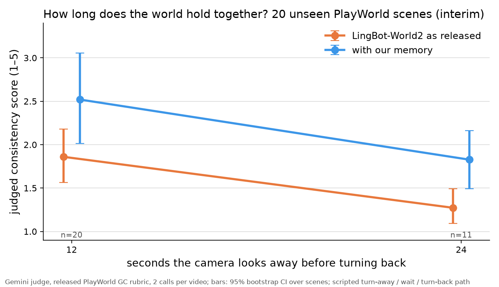
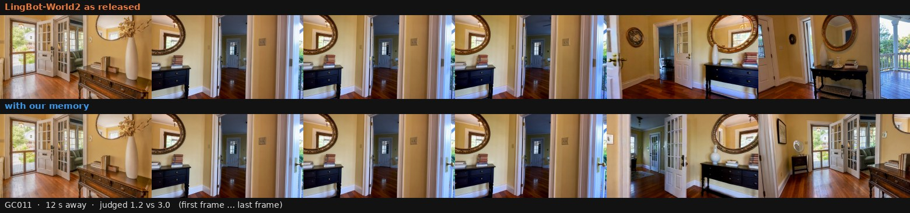
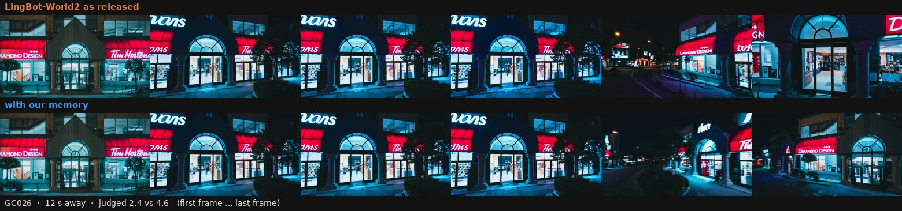
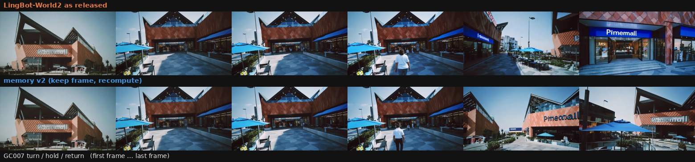

# WorldSync demo: making a generated world remember where it has been

**Track 4 question: how long can a generated world hold together while an agent plays in it?**

We took an open world model (LingBot-World2, 14B) and added a **training-free memory**: when the camera comes back to a place
it has already seen, the model is handed its own earlier frames of that place. It stores only the frame and recomputes the
model's internal state on demand, which takes **about 200× less memory** than storing that state.

**Hero video (20 s): [demo/hero.mp4](demo/hero.mp4)** · selected example, PlayWorld scene GC011, camera looks away for 12 s and turns back.
Left: LingBot-World2 as released. Right: with our memory.

## Headline results

| | Result | Status |
|---|---|---|
| 1 | **Looking away for 12 s and turning back, 20 unseen PlayWorld scenes: judged consistency 1.86 → 2.52, paired +0.66 [+0.19, +1.12], 14 wins / 2 ties / 4 losses** | pre-registered (interim) |
| 2 | **Memory footprint: 6.2 MB per remembered frame instead of 1,235 MB (about 200×), with the same recall** (0.77 vs 0.78 on the test path; stock 0.35) | one scene, one seed |
| 3 | **Published baseline reproduced twice with the open checkpoint: 1.85 and 1.81 overall, against the published 1.82** (171 PlayWorld tasks each) | full benchmark |
| 4 | **On PlayWorld's own tasks, the best subset is out-of-sight evolution with our text director: 1.32 → 1.53, a trend of +0.20 [−0.12, +0.58]** (37 held-out tasks, mean of 3 judge calls) | post-hoc choice of subset and metric; interval includes zero |

One honest line: on the full PlayWorld benchmark our methods score 1.80 to 1.86 overall, level with LingBot's published 1.82
and below Genie 3's 2.12, and no subset of PlayWorld's own tasks shows a gain whose interval excludes zero. The clear gain is on
long absences, which PlayWorld's own tasks rarely contain.

## 1. How long does the world hold together?

Twenty PlayWorld geometry-consistency scenes that we never used in development, chosen by a hash of the scene id. The camera
turns away 180°, waits, and turns back. Same seed and same GPU for both arms. The Gemini judge scores each video twice with
PlayWorld's released consistency rubric. The design was frozen before any video was generated
(`docs/demo/sources/revisit-horizon-config.json`). These are PlayWorld scenes with our own scripted
path, not PlayWorld's task list.

| seconds away | scenes | as released | with our memory | paired difference [95% CI] | wins/ties/losses |
|---:|---:|---:|---:|---|---|
| 12 s | 20 | 1.86 | 2.52 | +0.66 [+0.19, +1.12] | 14/2/4 |
| 24 s | 11 | 1.27 | 1.83 | +0.55 [+0.18, +0.95] | 9/1/1 |

Pooled over the 12 s and 24 s absences, scenes as units: +0.69 [+0.30, +1.08] (n = 20) (interim).

### Selected examples

Each clip shows the whole episode, sped up to about 10 s. Full rule-based set, including losses: [demo/APPENDIX.md](demo/APPENDIX.md).

**GC011, 12 s away: judged 1.2 → 3.0.** Stock comes back to a different wall and a porch railing; with memory the front door, sidelights and console table of the start view are back. [video](demo/horizon-win-GC011-H12.mp4)

**GC034, 12 s away: judged 2.0 → 4.2.** Stock comes back to a close-up through a fence with a different layout; with memory the stone gate and the wooden hut beside it are back. [video](demo/horizon-win-GC034-H12.mp4)

**GC026, 12 s away: judged 2.4 → 4.6.** Stock comes back to a close-up of a different shop door; with memory the red Diamond Design awning and arched entrance are back, seen from further away. [video](demo/horizon-win-GC026-H12.mp4)

## 2. About 200× less memory

To reuse an old frame, the model needs that frame's internal state at all 40 of its layers: 1,235 MB per frame. Our first
version stored that. Compressing it does not get far: 8-bit storage halves it, and keeping only some layers or a summary loses
most of the effect (`docs/demo/sources/memory-storage-ablation-table.md`). Memory v2 keeps only the
frame itself, 6.2 MB with its conditioning, and recomputes the internal state when the camera returns: 13.5 s of extra compute
in a 14-chunk episode, GPU memory 72.4 GB against 68.8 GB for the stock model.

It also acts only when it should. It retrieves when the camera really is back at a stored view, and is pixel-identical to the
stock model everywhere else. On a slow 360° turn, where our first version scored below stock (0.49 against 0.57), v2 scores
0.62 (`docs/demo/sources/memory-v2-step1-table.md`).

[Side-by-side video, GC007 turn / hold / return](demo/memv2-hold-GC007.mp4)

Stock ends at a storefront close-up; memory v2 ends on the Primemall facade and plaza seen at the start.

## 3. The baseline, reproduced

We ran all 171 PlayWorld tasks with the open LingBot-World2 checkpoint, an agent player and the released Gemini rubric, twice
on different hardware: **1.85 [1.67, 2.04]** and **1.81 [1.64, 1.99]** overall, against the published **1.82**
(`reproduction/full-run/table.md`, `reproduction/final-run/table.md`). An independent audit found no pipeline bug
(`reproduction/baseline-fidelity-audit.md`).

## 4. On PlayWorld's own tasks

We also tried a text "director" that writes the world model's prompt in the event-caption format it was trained on. Across all
171 tasks it is a small tendency, not an established gain: 1.81 → 1.82 with one judge call (+0.02 [−0.15, +0.19]) and
1.78 → 1.86 averaged over three (+0.07 [−0.06, +0.22]). Its best dimension, chosen after seeing the results, is out-of-sight
evolution on held-out tasks: 1.32 → 1.53, +0.20 [−0.12, +0.58], 9 wins / 19 ties / 9 losses.

Selected out-of-sight examples (more, including losses, in [GALLERY.md](GALLERY.md)):

**OE036: judged 1.0 → 5.0.** After the camera tilts up and returns, stock has replaced the man and dog; with the director they keep walking away. [video](gallery/outsight-OE036.mp4)

**OE030: judged 1.0 → 4.25.** Stock loses the ramp and the car; the director keeps the same car on the same ramp. [video](gallery/outsight-OE030.mp4)

Memory v2 on the PlayWorld tasks that contain a real revisit (pre-registered, interim, 12 pairs): paired judged difference -0.16 [-0.93, +0.56], 4/3/5 wins/ties/losses. No gain on real episodes.

## Demo script (2 minutes)

1. **The problem.** Play the left half of the hero video. The model looks away for 12 seconds, turns back, and the room it left is gone. It only remembers about 4.5 seconds.
2. **The fix.** Play the right half. We hand the model its own earlier frames of the place it is returning to. No training. The front door is back.
3. **It holds on scenes we never tuned on.** Show Figure 1. On 20 unseen scenes the judged score goes from 1.86 to 2.52 after 12 seconds away, 14 wins to 4 losses.
4. **It is cheap.** Show Figure 2. We keep the frame, not the model's internal state: 6 MB instead of 1.2 GB per frame, same recall.
5. **Where we stand, honestly.** We reproduced the published baseline twice (1.85 and 1.81 against 1.82). On PlayWorld's own tasks we are level with it, not above, because those tasks rarely look away for long. Long absences are where memory pays.

## Limits and what did not work

- **PlayWorld overall is unchanged.** First memory version 1.80 against stock 1.85; director 1.82 against 1.81. Neither is above Genie 3's 2.12, and the pre-registered criterion was not met (`reproduction/pass-criterion.md`).
- **PlayWorld's tasks rarely need memory.** Only 12% of geometry and out-of-sight chunks revisit a view the stock model had forgotten (`reproduction/full-run-memory-audit.md`).
- **The gain is in what the judge sees, not in our own similarity measure.** On the 20 unseen scenes, final-frame similarity to the start view is 0.48 against 0.50. The judge credits consistent objects and layout more than an exact return.
- **The judge is noisy.** The same video scored three times varies by about 0.36 points, so single examples can mislead; that is why the table reports intervals.
- **Forward-and-back moves are not undone by the model**, and memory cannot fix that. A fine-tuned memory adapter (48 training pairs) did not help and hurt ordinary generation.

## What we would do next

- **A trained memory layer**: a small adapter that reads a compact summary of past views, in place of substituting state at all 40 layers.
- **Retrieval by what is visible**, as in VMem, so forward-and-back returns pick the right frames.
- **Longer tasks**: a benchmark split where the agent is away for 10 to 30 seconds, which is where worlds fall apart.

Sources for every number: [LEADERBOARD.md](../LEADERBOARD.md), [docs/METHOD.md](METHOD.md), `docs/demo/horizon-summary.json`,
and the files named above. Assets are built by `scripts/build_demo.py` and this page by `scripts/write_demo_page.py`.
