# Side-by-side gallery: where our methods beat stock LingBot-World2, and where they do not

Base model: LingBot-World2 14B causal-fast (open checkpoint), unmodified weights. Every comparison here is our method
against the **stock model under the same harness, case, seed and GPU model**. Nothing on this page is a claim to beat
the published LingBot-World2 score (1.82) or Genie 3 (2.12); the numbers that decide that are in
[LEADERBOARD.md](../LEADERBOARD.md). How the methods work: [METHOD.md](METHOD.md).

Read the examples with the whole-run counts next to them. The examples are the extremes of a distribution whose
mean difference is close to zero.

## 1. Text director vs stock (final run `final1`, judged PlayWorld-style episodes)

**What the method is.** Before the episode, a small LLM (Claude Haiku 4.5) writes the world-model text prompt for the
case from the task caption, the objective and the reference plan only (no images, rubric or judge text): a present-tense
description of the subject and of the process that should keep going. The model, cache and sampler are stock.
It is applied to the IF, insight and out-of-sight cases; on GC the director arm is defined as identical to stock.

**The result these examples sit inside** (all 171 cases per arm, Lambda H100 PCIe, seed 42, one Gemini call per
episode, released PlayWorld rubric; computed with the frozen analysis script `scripts/final_run_score.py` on all
294 scored episodes at 07:27 PST on 2026-11-15; the committed table in `reproduction/final-run/` supersedes it):

| set | stock | director | paired director − stock [95% CI] |
|---|---:|---:|---|
| all 171 | 1.81 [1.64, 1.99] | 1.82 [1.66, 2.01] | **+0.02 [−0.15, +0.19]** |
| 151 held-out | 1.76 [1.58, 1.94] | 1.82 [1.65, 2.01] | +0.06 [−0.13, +0.26] |

So: **no established gain**. The interval is centred near zero. On the 20 development cases that were used to choose
the method, the director did not repeat its development result in this run (IF, insight and out-of-sight development
pairs: 1 win, 11 ties, 5 losses).

Wins, ties and losses by case (director − stock, single call each):

| cases | pairs | wins | ties | losses | mean difference | both arms at the 1.0 floor |
|---|---:|---:|---:|---:|---:|---:|
| IF, held-out | 45 | 18 | 15 | 12 | +0.13 | 14 |
| insight, held-out | 24 | 6 | 10 | 8 | +0.04 | 10 |
| out-of-sight, held-out | 37 | 6 | 26 | 5 | +0.08 | 24 |
| all three, held-out | 106 | 30 | 51 | 25 | +0.09 | 48 |
| all three, all cases | 123 | 31 | 62 | 30 | +0.03 | 58 |

**How the examples were chosen (a rule, not by eye).** Among held-out cases of the three dimensions the director
touches: the 6 largest positive and the 3 largest negative differences in the primary score, ties broken by task id,
with at least one case per dimension. The script is `scripts/build_gallery.py`; the selection with all scores is in
[gallery/selection.json](gallery/selection.json). The example list did not change between 80% and 100% of the run.

Each strip shows 6 evenly spaced frames per arm (stock on top, director below), the task objective, the director's
prompt and both scores. "What is visible" is my own reading of the frames and of denser contact sheets, written
after looking at each one; the judge's score is one call with a within-video standard deviation of about 0.35, and
individual calls on the same video have ranged from 1.0 to 5.0.

### Wins (largest positive differences)

**OE036, out-of-sight, +4.00 (stock 1.00, director 5.00).** Task: tilt the camera up 90 degrees, then return.
Visible: in the stock video the man and dog are gone after the tilt and the frame becomes a front-facing close-up of a
man; in the director video the same man and dog keep walking away down the road and are farther along at the end. A real,
visible difference. Caveat: the director arm's camera also tilts less far, so its subjects are out of view for less time.
[video](gallery/outsight-OE036.mp4)

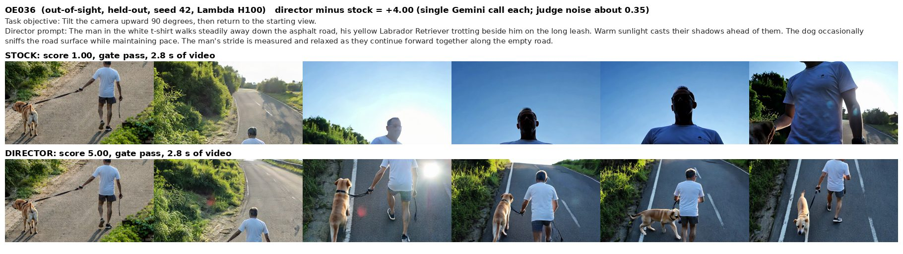

**OE073, insight, +3.80 (stock 1.00, director 4.80).** Task: wait and observe (static camera, 60 s).
Visible: both arms show the vendor ladling for the whole minute. In stock the container looks full, then empty, then
full again (a loop); in the director arm he works more slowly and the container fills once by the end. Subtle in stills.
The judge reads it as "food disappears" versus "accumulates". Note the director's prompt here says the vendor "pauses"
and the scene "remains calm", so the better score is not because the prompt asked for progress.
[video](gallery/insight-OE073.mp4) (sped up 7.5x)

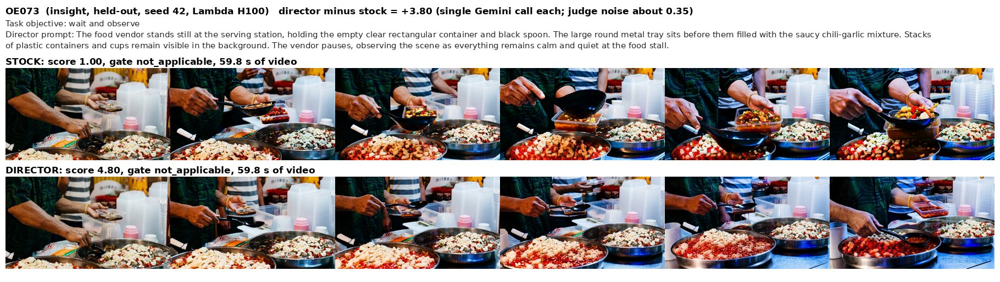

**OE018, insight, +3.40 (stock 1.00, director 4.40).** Task: wait and observe.
Visible: both arms show water pouring into the teapot for a minute with leaves swirling; I cannot see a clear
difference in the sampled frames. The judge says the water level never rises in stock and rises in the director arm,
and marks the director arm down for the kettle changing shape. Treat this gap as possibly judge noise.
[video](gallery/insight-OE018.mp4) (sped up 7.5x)

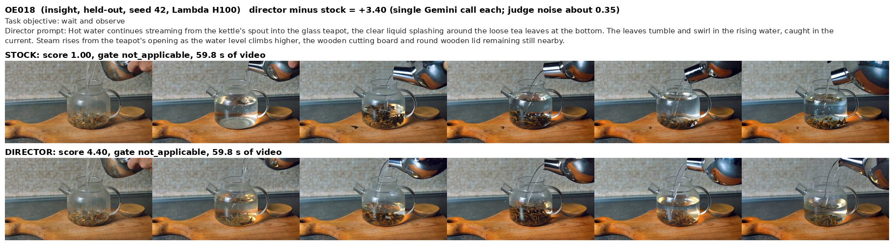

**OE030, out-of-sight, +3.25 (stock 1.00, director 4.25).** Task: pan down to follow the SUV down the spiral ramp, then tilt back up.
Visible: the stock video passes through a different, green-floored ramp with extra cars and ends on the building with
no ramp or SUV in view; in the director arm the same silver SUV stays on the same concrete ramp and is still there,
lower down, when the camera tilts back up. A real, visible difference.
[video](gallery/outsight-OE030.mp4)

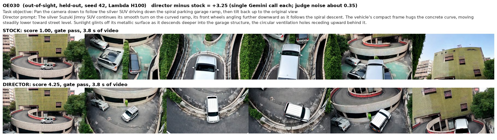

**OE029, out-of-sight, +3.17 (stock 1.00, director 4.17; second calls 1.00 and 3.67).** Task: turn right 60 degrees, walk forward, hold.
Visible: in stock a different large black engine fills the frame and the original locomotive is gone; in the director
arm the same numbered locomotive stays in view at the left with its carriages. Visible difference, and the second judge call agrees.
The episode lengths differ (3.8 s and 4.8 s) because the player made different choices.

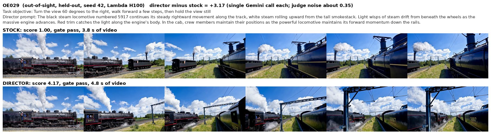

**IF013, IF, +3.00 (stock 1.00, gate fail; director 4.00, gate pass).** Task: the man rows the boat to the opposite shore.
Visible: in stock the boat stays against the snowy bank for the whole clip and the ice in front of it melts oddly; in the
director arm the boat leaves the bank and is in open water by the end, with oar splashes. This is the effect the director
was designed for: locally the movement keys only move the camera, so the subject's motion has to be stated in the text.

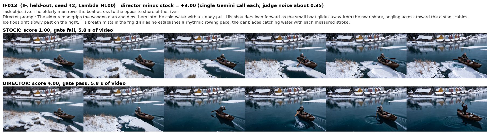

### Losses (largest negative differences)

**OE046, out-of-sight, −4.00 (stock 5.00, director 1.00).** Task: turn left 90 degrees, then turn back.
Visible: in stock the box has moved along the conveyor when the camera returns; in the director arm the box is back
near its starting place, so its position reset while unseen. The director's prompt asked for exactly the opposite
("the yellow box ... glides forward"), and the model did not follow it.

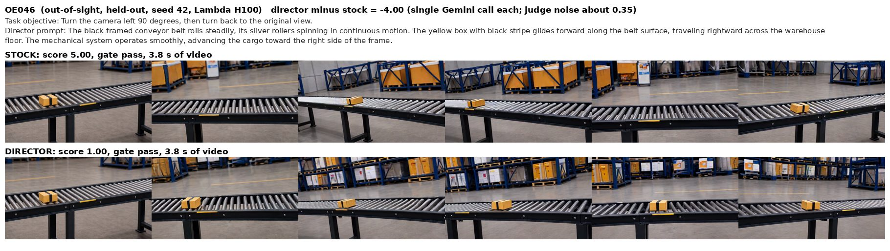

**OE020, insight, −3.00 (stock 5.00, director 2.00).** Task: wait and observe.
Visible: in stock cyclists and cars pass and the street stays readable; in the director arm cyclists repeatedly fill the
frame in close-up, and the judge reports the pedestrians behind them frozen in mid-step. The prompt's "several cyclists
pedal past" seems to have produced too many cyclists rather than a calmer, moving street.

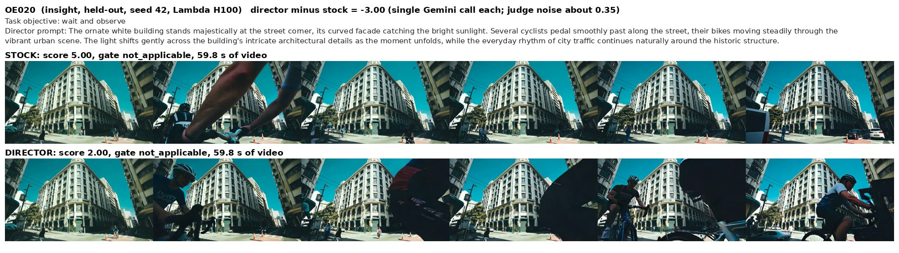

**IF019, IF, −2.67 (stock 4.67, director 2.00; second calls 4.00 and 1.80).** Task: ride the deer forward, then turn right toward the blue and white building.
Visible: in stock the deer stays the rider's mount in first person and turns toward the building; in the director arm
the viewpoint detaches and the deer is seen walking away from outside, so the "rider" relation is lost. The second
judge call agrees.

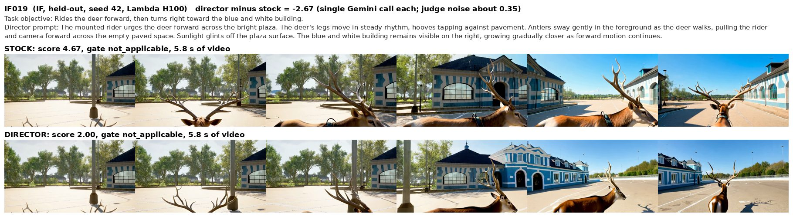

### What these nine show, honestly

- The director can produce clearly better episodes (OE036, OE030, OE029, IF013: subjects keep their identity or the
  subject finally moves) and clearly worse ones (OE046, OE020, IF019: state resets, clutter, lost viewpoint).
- The wins and losses are about equally large and about equally frequent, which is why the paired mean is near zero.
- Some large score gaps are not visible in the frames (OE018). With one judge call per video they cannot be told apart from judge noise.
- About 45% of the held-out pairs score exactly 1.0 in both arms: for those the text made no measurable difference.

## 2. Memory on scripted revisit paths (diagnostic, not a benchmark score)

These are fixed camera paths with a guaranteed return to the start view (Modal H200, GC007 "Primemall" scene). The
metric is DINOv2 similarity of the final frame to the start view: a crude, single-seed proxy. **The gain shown here
did not transfer to judged episodes**: on the full 171-case run, bounded pose memory scored 1.80 against stock 1.85
(paired −0.04 [−0.26, +0.16]). Why: [full-run-memory-audit.md](../reproduction/full-run-memory-audit.md).

**Turn away, hold 24 chunks, turn back** (columns: start view | farthest view | final view; rows from the top:
bounded pose memory K10 native 0.77, K10 virtual 0.71, K14 0.63, K6 0.56, 46/6 cache 0.88, stock 0.40).
Stock returns to an interior corridor; bounded memory with 10 or 14 retrieved frames and the larger cache return to the
Primemall facade (K6 only to a close-up of the sign), with lettering and framing still drifting. Source: [budgetmem](../reproduction/budgetmem/README.md).

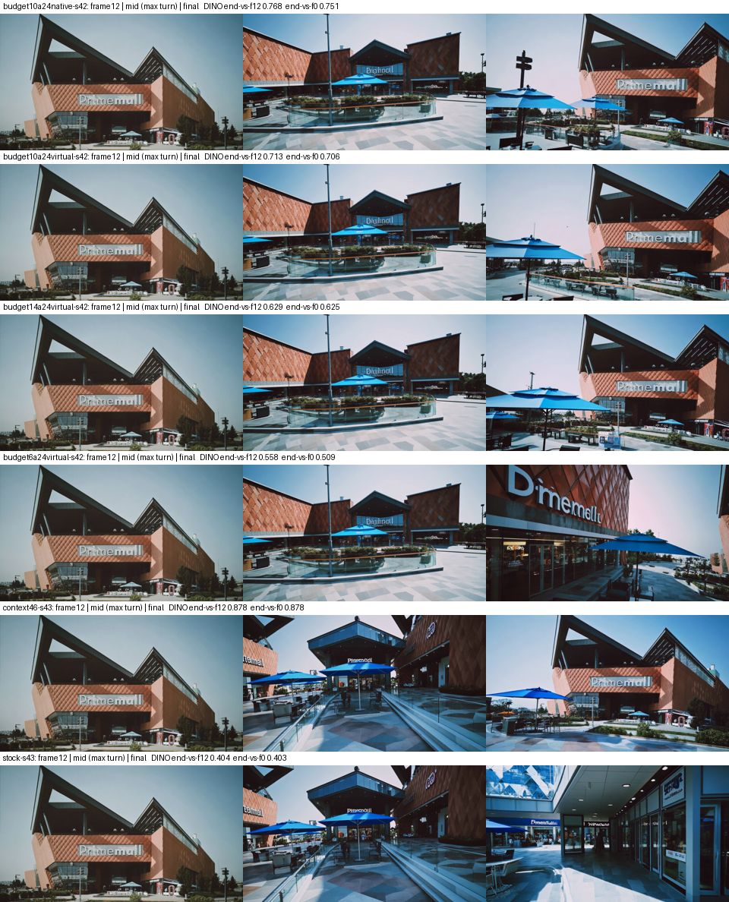

**The same path across the earlier methods** (rows from the top: 46/6 cache 0.90, DeCoPrune-style pruning 0.29,
WorldKV-style retention 0.65, re-anchoring 0.28, pose retrieval 0.56, stock 0.30). The larger cache returns to the
facade and WorldKV-style retention to a closer view of it; stock, re-anchoring and DeCoPrune-style pruning end on a wall.
Source: [revisit matrix](../reproduction/revisit/README.md).

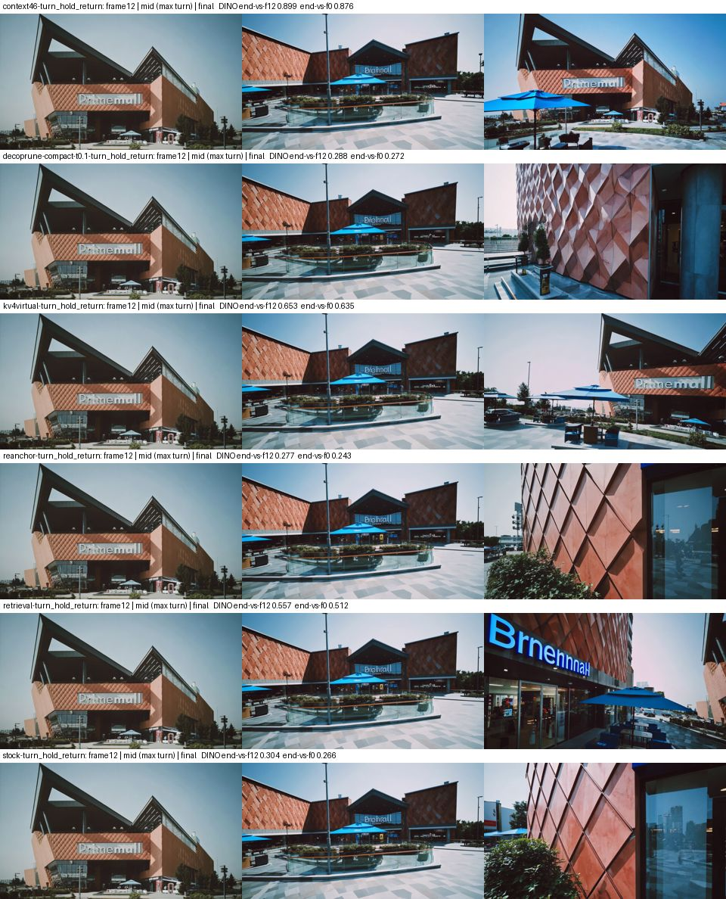

**Keyframe restart** (regenerate from a stored frame when the pose returns). The final view matches the start
(DINO 0.98-0.99) **by construction**, with hard cuts at each restart and anything that moved since the keyframe
discarded; the test scenes are static, so that cost is not visible here. Source: [keyframe-restart](../reproduction/keyframe-restart/README.md).

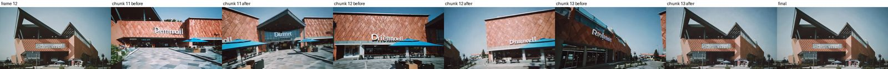

**The same memory in real judged episodes** (columns: start | farthest | return; rows in pairs, stock then bounded
memory, for GC007, OE044 and OE070). In GC007 both arms end at the mall doorway and in OE044 both end in a different part of the
kitchen; in OE070 the memory arm's return looks closer to the start than stock's. Most real returns are forward-then-back moves that the model does not visually undo, and retrieval keyed on
the commanded pose fetches the wrong content. Over 54 paired returns the start-to-return similarity is 0.597 for
stock and 0.596 for memory.

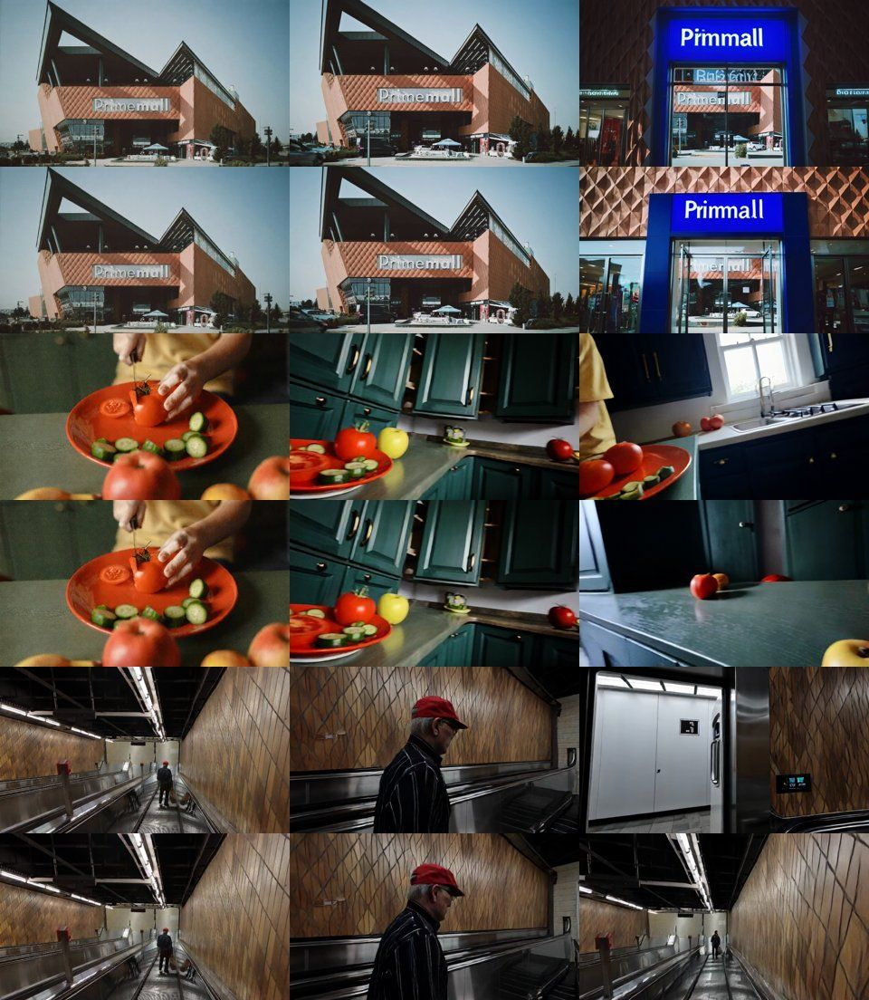

## Limits that apply to everything on this page

- One seed per case; one Gemini call per video for the primary score (within-video SD about 0.35).
- Lambda H100 PCIe for the director run, Modal H200 for the memory images; outputs are bit-exact only within one GPU model, so arms are compared only on the same hardware.
- The director variant was chosen on 20 development cases; examples above are held-out cases only.
- The player (Claude Haiku 4.5) makes its own choices, so paired episodes can differ in length and path.
- Local open checkpoint, our player and a preview judge model: not the hosted setup behind the published 1.82 and 2.12.
