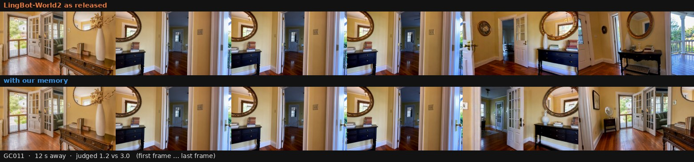
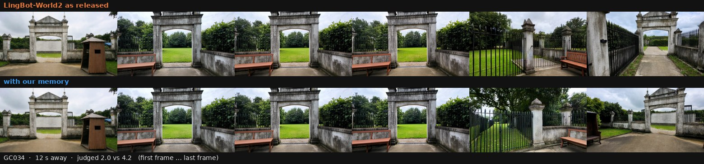
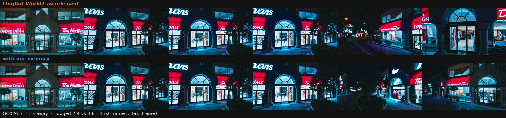
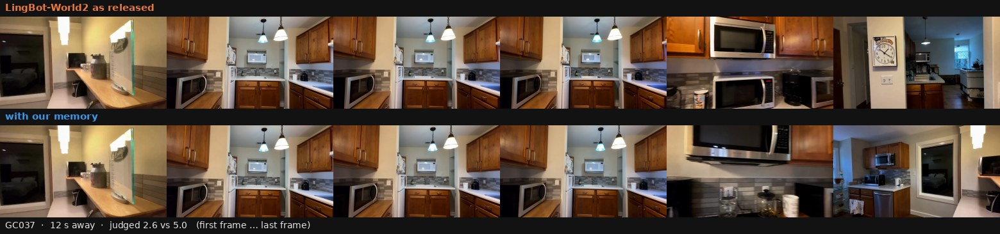
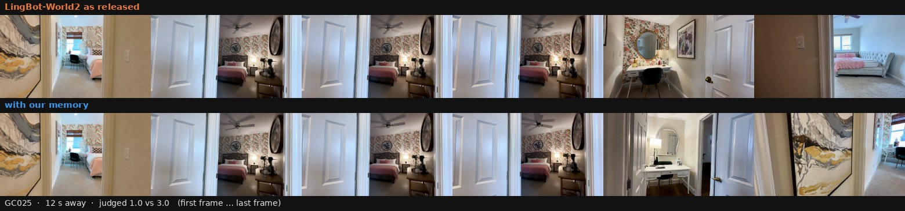
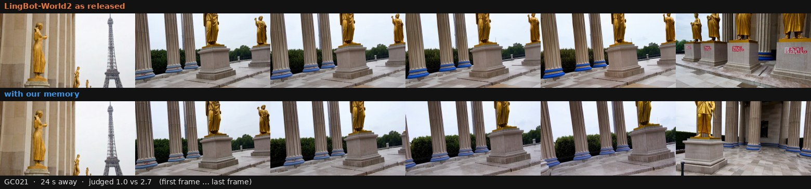
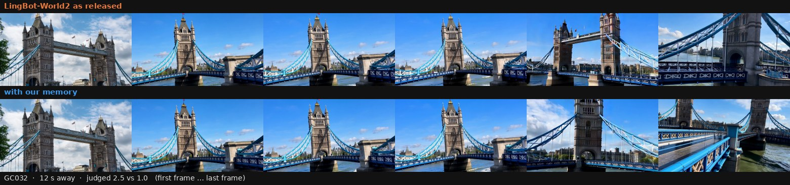
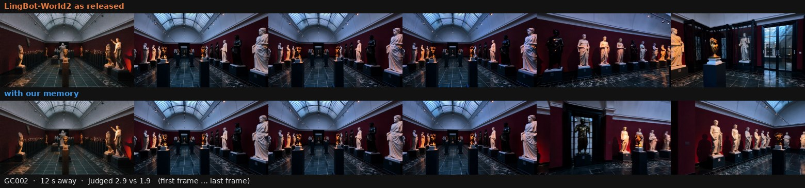
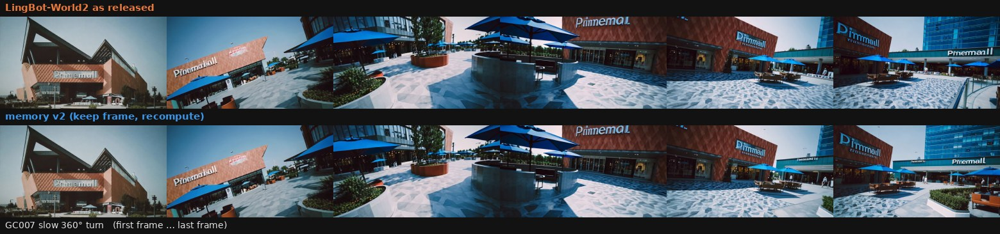

# Demo appendix: the full rule-based set

Rule: the largest paired judged differences at 12 s or 24 s away, one entry per scene, plus the most negative ones (interim). Every pair is in `horizon-summary.json`. Observations were written after viewing each strip.

| scene | away | as released | with memory | difference | judge calls (released / memory) | final-frame similarity |
|---|---:|---:|---:|---:|---|---|
| GC037 | 12 s | 2.60 | 5.00 | +2.40 | [2.6, 2.6] / [5.0, 5.0] | 0.38 / 0.41 |
| GC034 | 12 s | 2.00 | 4.20 | +2.20 | [1.4, 2.6] / [3.4, 5.0] | 0.75 / 0.81 |
| GC026 | 12 s | 2.40 | 4.60 | +2.20 | [3.2, 1.6] / [4.2, 5.0] | 0.34 / 0.67 |
| GC025 | 12 s | 1.00 | 3.00 | +2.00 | [1.0, 1.0] / [5.0, 1.0] | 0.60 / 0.18 |
| GC011 | 12 s | 1.20 | 3.00 | +1.80 | [1.4, 1.0] / [1.0, 5.0] | 0.55 / 0.68 |
| GC021 | 24 s | 1.00 | 2.70 | +1.70 | [1.0, 1.0] / [2.2, 3.2] | 0.54 / 0.67 |
| GC014 | 24 s | 1.10 | 2.60 | +1.50 | [1.0, 1.2] / [3.0, 2.2] | 0.58 / 0.54 |
| GC016 | 12 s | 1.40 | 2.80 | +1.40 | [1.2, 1.6] / [2.2, 3.4] | 0.24 / 0.77 |
| GC018 | 12 s | 1.40 | 2.70 | +1.30 | [1.2, 1.6] / [2.8, 2.6] | 0.16 / 0.49 |
| GC003 | 12 s | 2.60 | 3.80 | +1.20 | [2.6, 2.6] / [2.6, 5.0] | 0.65 / 0.28 |
| GC016 | 24 s | 1.00 | 2.10 | +1.10 | [1.0, 1.0] / [2.2, 2.0] | 0.21 / 0.37 |
| GC015 | 24 s | 1.20 | 2.20 | +1.00 | [1.0, 1.4] / [1.6, 2.8] | 0.34 / 0.33 |
| GC044 | 12 s | 1.10 | 1.80 | +0.70 | [1.2, 1.0] / [2.6, 1.0] | 0.55 / 0.21 |
| GC014 | 12 s | 1.80 | 2.20 | +0.40 | [1.8, 1.8] / [1.6, 2.8] | 0.59 / 0.53 |
| GC042 | 24 s | 1.00 | 1.40 | +0.40 | [1.0, 1.0] / [1.8, 1.0] | 0.20 / 0.27 |
| GC034 | 24 s | 2.10 | 2.40 | +0.30 | [1.6, 2.6] / [2.2, 2.6] | 0.26 / 0.38 |
| GC041 | 12 s | 1.90 | 2.20 | +0.30 | [1.6, 2.2] / [2.0, 2.4] | 0.05 / 0.10 |
| GC044 | 24 s | 1.00 | 1.30 | +0.30 | [1.0, 1.0] / [1.0, 1.6] | 0.12 / 0.15 |
| GC021 | 12 s | 1.30 | 1.50 | +0.20 | [1.4, 1.2] / [1.4, 1.6] | 0.65 / 0.70 |
| GC015 | 12 s | 1.70 | 1.90 | +0.20 | [1.0, 2.4] / [1.4, 2.4] | 0.15 / 0.15 |
| GC032 | 24 s | 1.30 | 1.50 | +0.20 | [1.6, 1.0] / [1.8, 1.2] | 0.57 / 0.53 |
| GC019 | 24 s | 1.10 | 1.20 | +0.10 | [1.2, 1.0] / [1.4, 1.0] | 0.17 / 0.58 |
| GC022 | 12 s | 3.70 | 3.80 | +0.10 | [5.0, 2.4] / [2.6, 5.0] | 0.88 / 0.88 |
| GC035 | 12 s | 1.50 | 1.50 | +0.00 | [1.2, 1.8] / [1.0, 2.0] | 0.39 / 0.48 |
| GC042 | 12 s | 1.00 | 1.00 | +0.00 | [1.0, 1.0] / [1.0, 1.0] | 0.14 / 0.09 |
| GC011 | 24 s | 1.70 | 1.70 | -0.00 | [2.2, 1.2] / [1.0, 2.4] | 0.55 / 0.53 |
| GC009 | 12 s | 1.60 | 1.40 | -0.20 | [2.2, 1.0] / [1.4, 1.4] | 0.70 / 0.85 |
| GC019 | 12 s | 1.60 | 1.10 | -0.50 | [2.0, 1.2] / [1.0, 1.2] | 0.80 / 0.73 |
| GC035 | 24 s | 1.50 | 1.00 | -0.50 | [2.0, 1.0] / [1.0, 1.0] | 0.61 / 0.61 |
| GC002 | 12 s | 2.90 | 1.90 | -1.00 | [2.6, 3.2] / [2.0, 1.8] | 0.47 / 0.52 |
| GC032 | 12 s | 2.50 | 1.00 | -1.50 | [2.4, 2.6] / [1.0, 1.0] | 0.56 / 0.51 |

## Clips

**GC011, 12 s away: 1.2 → 3.0.** Stock comes back to a different wall and a porch railing; with memory the front door, sidelights and console table of the start view are back. [video](horizon-win-GC011-H12.mp4)

**GC034, 12 s away: 2.0 → 4.2.** Stock comes back to a close-up through a fence with a different layout; with memory the stone gate and the wooden hut beside it are back. [video](horizon-win-GC034-H12.mp4)

**GC026, 12 s away: 2.4 → 4.6.** Stock comes back to a close-up of a different shop door; with memory the red Diamond Design awning and arched entrance are back, seen from further away. [video](horizon-win-GC026-H12.mp4)

**GC037, 12 s away: 2.6 → 5.0.** Stock comes back to a wall with a clock that was never there; with memory the dark window and counter of the start view are back, framed differently. [video](horizon-win-GC037-H12.mp4)

**GC025, 12 s away: 1.0 → 3.0.** Stock ends in a different bedroom; with memory the hallway painting from the start view is back. The two judge calls disagree (5.0 and 1.0). [video](horizon-win-GC025-H12.mp4)

**GC021, 24 s away: 1.0 → 2.7.** Neither arm returns to the Eiffel Tower view. With memory the single golden statue and colonnade stay consistent; stock adds extra statues and graffiti. Not a visible return. [video](horizon-win-GC021-H24.mp4)

**GC032, 12 s away: 2.5 → 1.0.** A loss. Neither arm returns to the bridge view; with memory the final frames show a distorted blue railing. [video](horizon-loss-GC032-H12.mp4)

**GC002, 12 s away: 2.9 → 1.9.** A loss. Neither arm returns to the central gallery view; stock's final view is the more coherent one. [video](horizon-loss-GC002-H12.mp4)

## Memory v2 on a slow 360° turn (GC007)

Both arms end on a similar plaza view, not the start view; the similarity scores are 0.57 (stock) and 0.62 (v2). The point of this path is that v2 no longer scores below stock, as the first version did (0.49).

