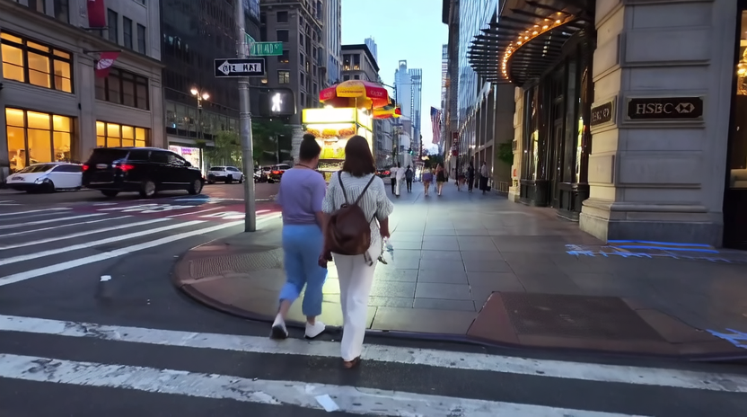
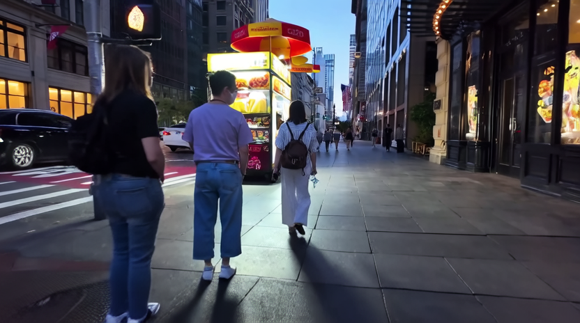
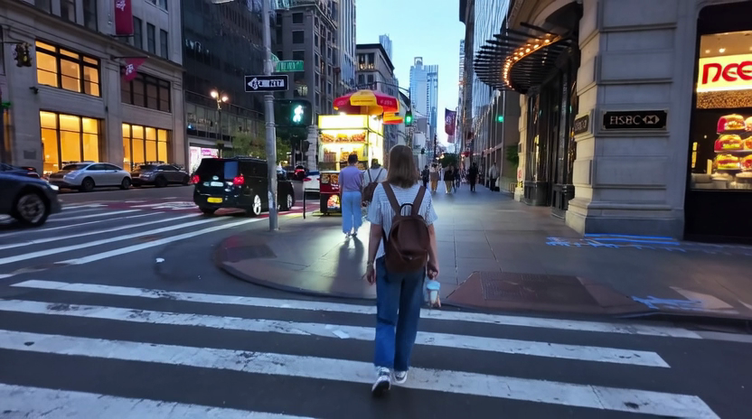
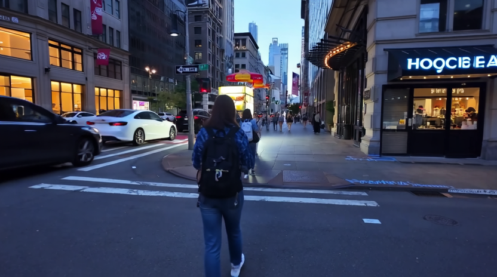

# GC024: first paired result and visual limitations

This is one development case, seed 42, both arms on the same H100SXM. It does not estimate the full benchmark. All three declared judgments are retained: legacy 2.2, 1.4, 4.2 (mean 2.60); corrected 1.0, 1.0, 1.2 (mean 1.07). Every report's video hash matches the corresponding completed local video. See [comparison report](report.md).

The configurations differ in text, controller and stopping policy. Legacy ended after 7 chunks (6.8125 seconds); corrected rendered all 60 chunks (59.8125 seconds), continuing with WAIT after the command plan ended. Therefore the score difference cannot isolate the controller or memory quality. Neither an earlier stopping rule nor a cropped video would establish improved long-horizon consistency.

## Selected frames

These are inspected diagnostic checkpoints, selected after seeing the result; they are not an independent metric. The corrected PNG observations are saved before the corresponding generation chunk. The legacy image was decoded from its video at 6.75 seconds.

| Initial | Corrected before chunk 7 (about 6.8 s) |
|---|---|
|  |  |

| Legacy at 6.75 s | Corrected before chunk 13 (about 12.8 s) |
|---|---|
|  |  |

Visual observations:

- The initial person with the brown backpack has light trousers. The legacy final frame shows blue trousers. Its higher mean score is not evidence of perfect identity preservation.
- The corrected view near 12.8 seconds shows a large blue illuminated sign and shop opening on the right-hand corner, compared with the initial HSBC entrance/sign. Structural and appearance drift is already visible near completion of the motion plan, before most of the long WAIT period.
- These views differ in camera position and visible people. They do not supply ground-truth poses or prove that any specific intervention caused the drift.

The corrected player made six live calls. Its plan completes in chunk 13 with commanded position `(0, 0, -3.2914)` in normalized units after unequal online phase extensions. Equal nominal forward/backward durations do not guarantee equal executed displacement under that policy. Command odometry must not be presented as an observed visual return.

The task is third-person: it asks the backpack wearer to walk forward and then backward. LingBot's adapter conditions camera rays, not a trained avatar-control head. Camera motion, the person's motion, and scene consistency must be assessed separately. Two corrected judge calls found no backward walk; the third accepted the trajectory. The released gate does not require a revisit for this case.

No run settings were changed after this result. The remaining declared cases continue before any baseline promotion or algorithm hillclimbing.
