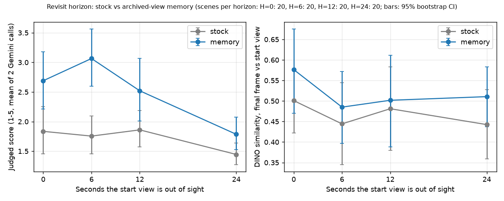
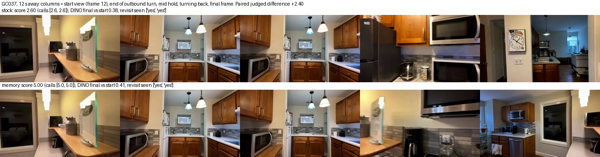
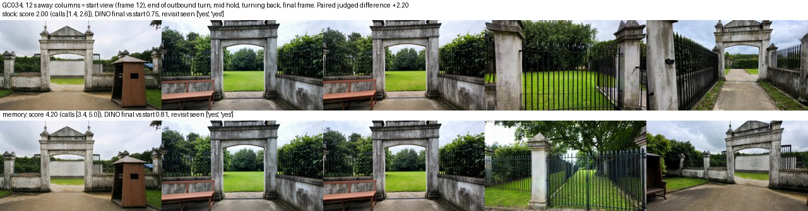
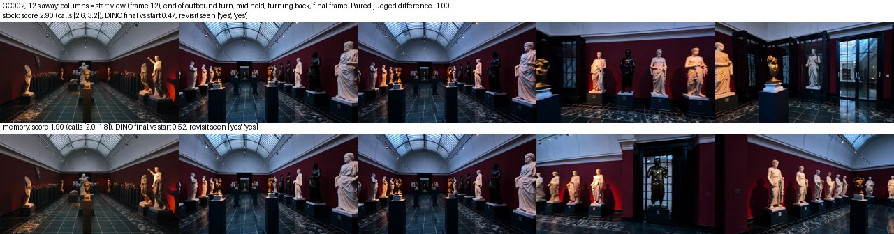
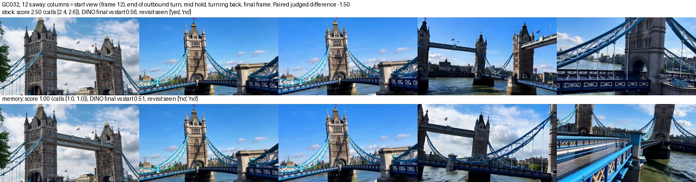

# Revisit horizon: how long can the camera look away?

**Result.** On 20 held-out scenes, archived-view memory raises the judged score at every absence length
we tested, with all four 95% intervals above zero. The gain is largest at 6 seconds away and shrinks by 24 seconds.
It is a scripted-path benchmark, not a PlayWorld leaderboard score.

| Seconds away | Scenes | Stock | Memory | Paired difference [95% CI] | Wins / ties / losses |
|---:|---:|---:|---:|---|---|
| 0 | 20 | 1.84 | 2.69 | +0.85 [+0.28, +1.47] | 13 / 1 / 6 |
| 6 | 20 | 1.76 | 3.06 | +1.31 [+0.74, +1.90] | 17 / 1 / 2 |
| 12 | 20 | 1.86 | 2.52 | +0.66 [+0.18, +1.13] | 14 / 2 / 4 |
| 24 | 20 | 1.44 | 1.79 | +0.34 [+0.05, +0.64] | 12 / 3 / 5 |

Pooled over 6, 12 and 24 seconds, with scenes as the resampling unit: **+0.77 [+0.51, +1.04]**.
Scores are the released PlayWorld verifier's official 1-5 score, mean of two Gemini calls per video.

## What was run

- **Frozen first.** [`revisit-horizon-config.json`](revisit-horizon-config.json) and the 160-job list were committed
  (`7c15041`) before any generation. Nothing was changed afterwards.
- **Scenes.** 20 GC scenes chosen by a salted hash of the case id, after excluding the 10 scenes used to develop
  or validate any memory method (GC001, GC006, GC007, GC010, GC013, GC027, GC033, GC040, GC045, GC046).
- **Path.** Hold the start view for 1 s, turn right about 180 degrees (3 s), stay away for 0, 6, 12 or 24 s,
  turn back (3 s), hold 1 s. Fixed actions, no player.
- **Arms.** Stock LingBot-World2 14B causal-fast, and the same weights with exact bounded pose memory
  (`--budget-memory --budget-rope native --budget-retrieved 10 --budget-store exact`). Seed 42, same GPU model
  (Lambda H100 PCIe) for both arms. No training.
- **Judge.** Each scene's released GC record (image, caption, policies and its own rubric questions) with the
  objective replaced by the scripted one, e.g. "Turn right 180 degrees, wait for 12 seconds, then turn back to
  the original view." The dataset has objectives worded this way (OE053). Gate, rubric and aggregation are the
  released code; the model is `gemini-3.1-pro-preview` on Vertex. The judge sees no arm label.
- **Coverage.** 160 of 160 videos generated, 320 of 320 judge calls returned, no errors, nothing excluded.

## What the judge is rewarding

The similarity of the final frame to the start view (DINOv2 CLS) barely moves:

| Seconds away | Stock DINO | Memory DINO | Paired difference [95% CI] |
|---:|---:|---:|---|
| 0 | 0.50 | 0.58 | +0.08 [-0.02, +0.18] |
| 6 | 0.44 | 0.49 | +0.04 [-0.03, +0.11] |
| 12 | 0.48 | 0.50 | +0.02 [-0.07, +0.12] |
| 24 | 0.44 | 0.51 | +0.07 [-0.00, +0.14] |

So the judged gain is not "the last frame matches the first". The rubric categories say where it comes from
(exploratory, not pre-registered; means over judge calls that reached the rubric):

| Seconds away | Arm | Object identity | Texture | Colour | Relative position |
|---:|---|---:|---:|---:|---:|
| 6 | stock | 1.25 | 2.15 | 2.80 | 1.32 |
| 6 | memory | 2.60 | 3.30 | 3.98 | 2.85 |
| 24 | stock | 1.03 | 1.71 | 2.45 | 1.13 |
| 24 | memory | 1.26 | 2.38 | 2.87 | 1.26 |

The judge also reports the revisit as observed more often with memory: 37 of 40 calls against 22 of 40 at 0 s,
and 37 of 40 against 29 of 40 at 24 s. Gate verdicts are in [`robustness.json`](revisit-horizon/robustness.json).

## Where it still breaks

- **It fades with time away.** The paired gain is +1.31 at 6 s and +0.34 at 24 s. At 24 s object identity is near
  the floor for both arms (1.03 against 1.26): after a long absence the scene is mostly not found again, with or
  without this memory.
- **Neither arm returns to the start view exactly.** In the strips below the camera comes back to the right place
  in some scenes and to a different part of the scene in others.
- **Losses are real.** 4 of 20 scenes are worse with memory at 12 s (GC032, GC002 below).
- **Our prediction was wrong at 0 s.** The config predicted little difference at 0 s, because the start view should
  still be in the stock window. Memory helps there too (+0.85).
- **Memory design.** This arm retrieves stored frames on every chunk of the hold, not only on the return. That is the
  flaw the memory audit found. A version that retrieves only on real revisits was not ready when the config was frozen.

## Examples, chosen by rule

At 12 s away, the two largest and the two smallest paired judged differences (ties broken by hash order).
Each strip shows stock on top and memory below: start view, end of the outbound turn, mid hold, turning back, final frame.

- **GC037, +2.40.** Stock ends on a different wall of the kitchen. Memory ends back at the counter with the dark
  window and the hanging lamp from the start view, framed differently.
  
- **GC034, +2.20.** Both end at the stone gate. With memory the gate and the fence beside it match the start view
  more closely. The difference is modest by eye.
  
- **GC002, -1.00.** Neither arm returns to the start of the sculpture hall. Memory ends on a different row of statues.
  
- **GC032, -1.50.** Neither arm returns to the first view of the bridge. Memory ends on the bridge deck, and the judge
  fails its trajectory on both calls.
  

## Limits

- **Scripted, not played.** The camera path and objective are ours. This measures revisit consistency on a path
  that forces a revisit. It is not comparable with PlayWorld's 1.82 or 2.12, where the same memory showed no gain.
- **Rotation only.** The memory audit found that forward-then-back returns are not helped.
- **Judge noise is large.** Two calls on the same video differ by 0.6 to 1.0 on average. With one call alone the
  paired gain is still positive at every horizon, but three of the eight single-call intervals include zero
  (see `robustness.json`). The pre-registered primary metric is the mean of two calls.
- **One seed, one judge model, 20 scenes.** The questions are each GC task's released questions, written for that
  task's own objective and applied here to ours.
- **Cost.** Memory jobs took about 1.2 to 1.4 times as long as stock (303 s against 222 s at 12 s away) and peaked
  at 75.6 GB against 72.5 GB.

## Files

- [`revisit-horizon-config.json`](revisit-horizon-config.json), [`revisit-horizon-jobs.jsonl`](revisit-horizon-jobs.jsonl): frozen design and jobs.
- [`revisit-horizon/analysis.json`](revisit-horizon/analysis.json): every episode's two call scores, gate verdicts, DINO values, and the paired tables.
- [`revisit-horizon/table.md`](revisit-horizon/table.md), [`robustness.json`](revisit-horizon/robustness.json), `horizon.png`, four strips.
- [`revisit-horizon/judge/`](revisit-horizon/judge/): the 320 verifier outputs.
- `scripts/revisit_horizon.py` (`freeze`, `score`, `analyze`), `scripts/revisit_horizon_robustness.py`.
