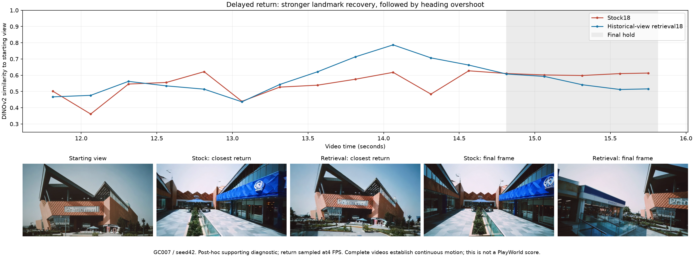

# Historical-view retrieval on realized turn returns

The unchanged virtual-position PoseKVMemory prototype improves GC007 seed42 on both short and delayed pure-turn paths. Its earlier translation-path experiment failed; that result remains published. These are development mechanism tests, not PlayWorld scores.

Archive 16 early non-sink key/value frames on CPU, select 4 by commanded pose overlap, reapply native spatial RoPE and recent virtual temporal positions, and attend to sink 6 + retrieved 4 + tail 8 = the same 18-frame budget as stock. The archive is bounded at 19.765 GB; peak GPU allocation is about 85.3 GB versus stock 80.4 GB. This is a prototype inspired by WorldKV/WorldTrace, not a paper reproduction.

On the 7.8125-second path, native camera audit and four-chunk exact pixel prefix pass. Endpoint DINO rises 0.579→0.738; a blinded full-video review prefers retrieval for preserving the returning roof, sign and facade. Frame PSNR declines and framing still drifts.

On the 15.8125-second path with an eight-second away-view hold, native audit and five-chunk exact prefix pass. Both rolling cache 18 and cache 34 fail to recover the original building. Retrieval returns through the same intermediate landmarks and restores the original Primemall identity continuously, according to the high-confidence blinded review. It then overshoots left: the final frame crops the recovered building to the edge. Endpoint DINO consequently falls 0.613→0.516, while PSNR rises 7.565→8.244 dB. We report this disagreement explicitly: it is a visual memory gain with imperfect camera closure, not improved final-frame reconstruction. Judge evidence and complete videos are retained for inspection.

Warmed generation takes 47.59 s versus 37.58 s stock on the short path, and 101.56 s versus 82.46 s on the delayed path. CPU archive transfers add overhead. No latency speedup is claimed. The method stores only an early segment and uses intended poses rather than reconstructed actual camera poses; it is not yet a general spatial memory map.

The method is frozen for the new-seed, image-held-out and 32-second tests in ../memory-validation-plan.json. Exact native-key positions are also being tested as a separate positional ablation; those results do not change the frozen candidate. No training, image editing, or output frame pasting is used.

A post-hoc diagnostic samples the entire return at 4 FPS to separate framing error from identity loss. Peak DINO similarity is 0.627 stock versus 0.787 retrieval, consistent with the continuous landmark recovery seen in the full video. The final-frame metric still declines and is reported above; this supporting metric does not replace the frozen evaluation. All sampled values are in turn_wait_return/revisit-segment.json.

