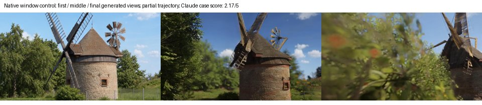

# Native-resolution comparison

This is a single-case development comparison at ABot's native 704×1280 setting,
using GPT-6.1 Sol as the player and Claude Opus 5.5 as the judge. It is not an
official aggregate PlayWorld score. The shared pilot budget is 12 decisions and
32 latent blocks, with seed 42 and frozen pretrained weights.

| GC004: move right, then return | Trajectory verdict | Effective case score |
| --- | --- | ---: |
| Stock | Partial | 2.0 / 5 |
| Window control | Partial | 2.17 / 5 |
| Landmark memory | Running | Pending |

Unlike the reduced-resolution pilot, the native stock model responds to rightward
movement. The judge observes a return through the starting region, followed by
substantial over-travel. It also identifies windmill-blade/fantail deformation,
material drift and severe blur while passing through foliage. The player exhausts
its budget rather than declaring success.

The window control also passes through the starting region but overshoots and
does not finish at the original position. Its 2.17 case score is a single judge
measurement, not evidence of a reliable gain over stock and not comparable with
the published 2.12 aggregate leaderboard score.

These observations show that resolution affected the earlier control test. They
do not establish a memory-policy improvement. The matched native window and
landmark run is still in progress. [Measurements](summary.json) and the full
[Claude judgment](stock-judge.json) are saved here.
