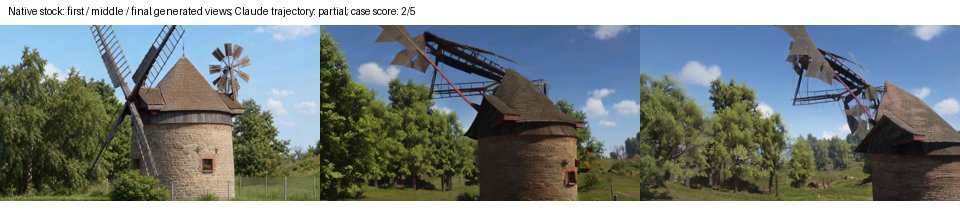
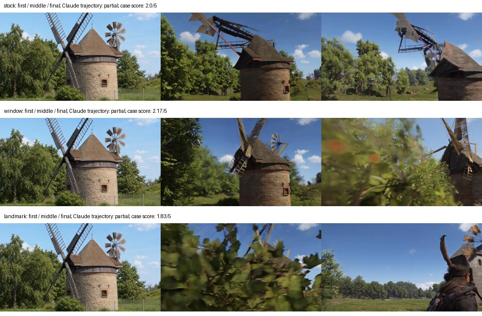

# Native-resolution comparison

This is a single-case development comparison at ABot's native 704×1280 setting,
using GPT-6.1 Sol as the player and Claude Opus 5.5 as the judge. It is not an
official aggregate PlayWorld score. The shared pilot budget is 12 decisions and
32 latent blocks, with seed 42 and frozen pretrained weights.

| GC004: move right, then return | Trajectory verdict | Effective case score |
| --- | --- | ---: |
| Stock | Partial | 2.0 / 5 |
| Window control | Partial | 2.17 / 5 |
| Landmark memory | Partial | 1.83 / 5 |

Unlike the reduced-resolution pilot, the native stock model responds to rightward
movement. The judge observes a return through the starting region, followed by
substantial over-travel. It also identifies windmill-blade/fantail deformation,
material drift and severe blur while passing through foliage. The player exhausts
its budget rather than declaring success.

The window control also passes through the starting region but overshoots and
does not finish at the original position. Its 2.17 case score is a single judge
measurement, not evidence of a reliable gain over stock and not comparable with
the published 2.12 aggregate leaderboard score.

The landmark variant is worse on this case. Claude flags a stretched windmill
tail, a tower changing from stone to red brick, and a character appearing without
being requested after the camera passes through foliage. The final character is
also visible in the saved frames. Retaining old keys did not preserve this world.

| Method | Peak allocated GPU memory, decimal GB | Mean steady seconds/block |
| --- | ---: | ---: |
| Stock | 39.31 | 5.52 |
| Window control | 42.60 | 6.93 |
| Landmark memory | 42.60 | 6.63 |

All three videos contain 23.8125 simulated seconds. Times include generation,
decoding and frame/video recording, exclude API deliberation, and omit the first
block from the mean. They are descriptive measurements on NVIDIA Thor, not a
dedicated throughput benchmark. Peak allocated memory excludes inactive reserved
allocator memory and is not a total-system-memory measurement.

The comparison is complete. Resolution affected the earlier control test, but
native resolution does not establish a memory-policy improvement either. One
scene, one seed, a custom player and a substitute judge cannot support a reliable
benchmark-gain claim. [Measurements](summary.json) and the full Claude judgments
are saved here. The next research step is to investigate pose-aware retrieval and
separate persistent scene appearance from changing object state, rather than
scaling this unvalidated retention heuristic to the entire benchmark.
