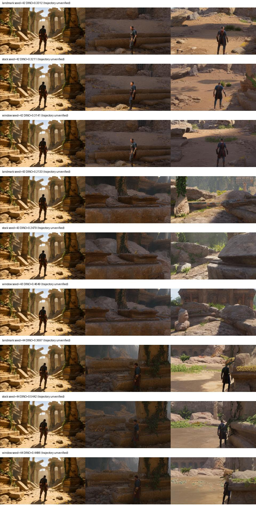
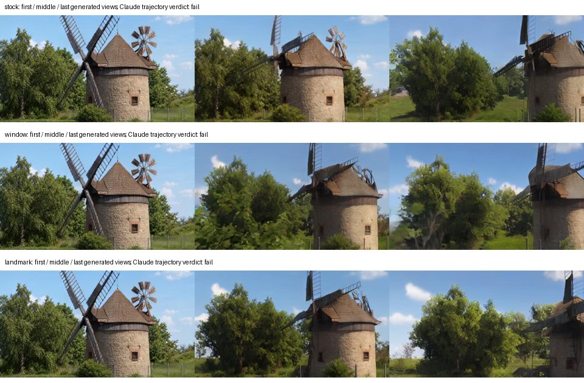

# Initial development pilot

This is a measured negative result, not a PlayWorld leaderboard submission.
All runs use frozen ABot-World-0-5B-LF weights at 352×640. The memory policy is
inspired by WorldTrace-Landmark, with no training or weight changes.

| Fixed-action pan-and-return | Mean DINO cosine, 3 seeds | Steady seconds/block |
| --- | ---: | ---: |
| Stock | 0.3711 | 1.319 |
| Window control | 0.4092 | 1.633 |
| Landmark memory | 0.3048 | 1.609 |

The inspected seed-42 trajectories did not return to the initial view. Their
appearance scores cannot establish a memory gain. The landmark policy's mean
appearance proxy is also lower than both controls.

An adaptive GPT-6.1 Sol player then attempted PlayWorld example **GC004**: move
right ten steps and return. The same agent prompt, seed, 12-decision budget and
32-block limit were used across methods. Claude Opus 5.5 judged the videos using
PlayWorld's trajectory rubric and dual-scale contact sheets.

| Method | Decisions | Blocks | Player stopped itself | Claude trajectory verdict | Effective case score |
| --- | ---: | ---: | --- | --- | ---: |
| Stock | 7 | 20 | Yes | Fail | 1 |
| Window control | 12 | 32 | No | Fail | 1 |
| Landmark memory | 12 | 32 | No | Fail | 1 |

The stock player counted executed commands as a successful return even though
the final view differed. The judge observed little effective rightward movement,
followed by leftward movement without a valid return. Window and landmark runs
also failed the required trajectory. The separate judge prevented false success.

These are **one-case Claude-judged scores**, not the published aggregate PlayWorld
score. The judge provider, custom controller, pilot budget and reduced resolution
differ from the paper. Native 704×1280 stock calibration is running to check the
resolution confound before attributing the control failure to the starting model.

[Machine-readable measurements](summary.json) include model revisions and video
hashes. Full judge results are stored alongside this report; their evidence fields
use the Chinese field names requested by the upstream rubric. Videos and API
credentials remain local under ignored paths.
